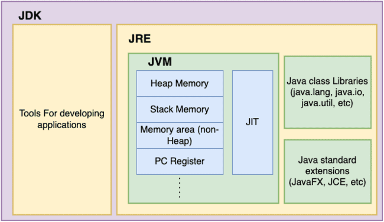

# Java Overview

## Why Java?

- **Paradigm Shift:** Before Java, most mainstream languages (such as C) were procedural, focusing on functions and sequential execution routines.
- **Object-Oriented Focus:** Java introduced pure object-oriented programming (OOP) to mainstream application development, emphasizing data encapsulation, state management, and reusable components.
  - *Procedural Approach:* Operations and data are separated. For example, a standalone function calculates the area of a box by accepting dimensions as arguments.
  - *Object-Oriented Approach:* Data and behavior are bundled together into a `Box` class with fields (`length`, `width`, `height`) and methods (`area()`).

---

## How Java Works

1. **Compilation:** Java source code (`.java`) is compiled by the Java compiler (`javac`) into platform-independent bytecode (`.class` files).
2. **Bytecode Portability:** Bytecode is an intermediate instruction set designed for execution by the Java Virtual Machine (JVM), enabling the "Write Once, Run Anywhere" (WORA) philosophy.
3. **Execution:** The JVM interprets bytecode and uses the Just-In-Time (JIT) compiler to compile performance-critical bytecode into native machine instructions at runtime.
4. **Platform Dependence:** While Java bytecode is platform-independent, the JVM itself is platform-specific (distinct implementations exist for Windows, Linux, macOS, etc.).
5. **Runtime Services:** The JVM provides automatic memory management (Garbage Collection), security sandboxing, thread management, and multi-language support on the JVM platform (e.g., Kotlin, Scala, Groovy).

---

## Java Platform Components

### 1. JDK vs JRE vs JVM

- **JVM (Java Virtual Machine):** The runtime execution engine that loads, verifies, and executes bytecode.
- **JRE (Java Runtime Environment):** JVM plus core runtime class libraries (`java.lang`, `java.util`, `java.io`). Required for running Java applications.
- **JDK (Java Development Kit):** Full development bundle containing JRE, compiler (`javac`), debugger (`jdb`), archiver (`jar`), disassembler (`javap`), and development utilities (`jshell`, `jconsole`).

### 2. Core Architecture Subsystems

| Subsystem | Components | Purpose |
| :--- | :--- | :--- |
| **Development Tools** | `javac`, `java`, `jar`, `javadoc`, `javap`, `jshell`, `jconsole`, `jdb` | Code compilation, packaging, inspection, and debugging |
| **JVM Execution Engine** | Class Loader Subsystem, Interpreter, JIT Compiler, Garbage Collector (GC) | Loading bytecode, memory allocation, execution, and cleanup |
| **Runtime Data Areas** | Method Area (Metaspace), Heap Memory, Stack Memory, PC Registers, Native Method Stacks | Memory partitions managed by the JVM during execution |
| **Native Interface** | Java Native Interface (JNI), Native Method Libraries | Interoperability with C/C++ libraries and OS-level system calls |
| **Core Class Libraries** | `java.base` (`java.lang`, `java.util`, `java.io`, `java.nio`, `java.net`, `java.math`, `java.time`) | Standard foundational APIs provided by the Java standard library |
