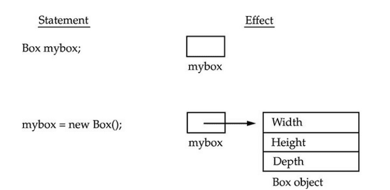
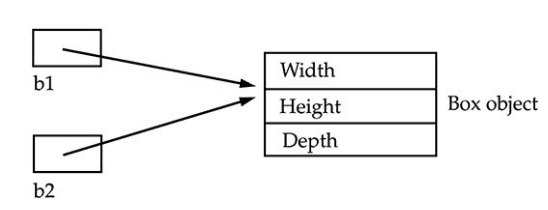

# Object Instantiation and Java Memory Allocation

## Overview

In Java, all objects are dynamically allocated at runtime. Understanding how objects are stored, referenced, and managed in memory is essential for writing efficient and bug-free Java programs.

Consider the following `Box` class definition:

```java
public class Test {
    public static void main(String[] args) {
        // Execution entry point
    }
}

class Box {
    int height;
    int width;
    int length;

    public Box(int height, int width, int length) {
        this.height = height;
        this.width = width;
        this.length = length;
    }

    int area() {
        return this.height * this.length * this.width;
    }
}
```

---

## How Objects are Stored and Referenced

### 1. Reference Variable Declaration
When a reference variable is declared without initialization, only a variable slot is created on the call stack. It does not point to any valid object in memory.

```java
Box b1; // Declares a reference variable on the stack pointing to nothing
```

### 2. The `new` Operator
The `new` operator dynamically allocates memory on the **Heap** at runtime to store the object's instance fields and invokes the appropriate constructor to initialize state:

```java
Box b1 = new Box(1, 1, 1); // Allocates object on the Heap and assigns address to b1
```

- **Reference Address:** The variable `b1` stores the memory reference (address pointer) to the allocated object in heap memory.
- **Member Access:** Instance fields and methods cannot be accessed until the reference points to an instantiated object.





---

## Reference Assignment and Aliasing

In Java, reference assignment (`=`) copies the memory reference (address), not the underlying object data. When multiple reference variables point to the same heap object, modifying the object via one reference affects all references pointing to that same object (aliasing).

```java
public class Test {
    public static void main(String[] args) {
        Box b1 = new Box(1, 1, 1);
        Box b2 = b1; // b2 now points to the exact same heap object as b1

        b1.length = 2;
        // Since b1 and b2 reference the same object, b2.length reflects the change
        System.out.println("b2.length: " + b2.length); // Outputs: 2

        Box b3 = new Box(3, 3, 3);
        b2 = b3; // b2 now points to the new Box object; b1 still points to original object
        System.out.println("b1.length: " + b1.length); // Outputs: 2

        b3 = null; // b3 no longer references the object; b2 still retains the reference
        System.out.println("b2.length: " + b2.length); // Outputs: 3
    }
}
```

---

## Uninitialized References vs Null References

```java
// Uninitialized local reference: Compiler error (variable might not have been initialized)
Box box1;
// box1.toString(); // Compilation error

// Null reference: Compiles successfully, but throws NullPointerException at runtime
Box box2 = null;
// box2.toString(); // Throws java.lang.NullPointerException
```

---

## JVM Runtime Memory Architecture

The Java Virtual Machine divides runtime memory into distinct regions to optimize data locality, execution speed, and garbage collection:

```
+-----------------------------------------------------------------------+
|                             JVM Memory                                |
|                                                                       |
|  +--------------------------------+  +-----------------------------+  |
|  |           Heap Memory          |  |       Metaspace / Method    |  |
|  |  (Objects, Arrays, Instance    |  |  (Class metadata, Method    |  |
|  |   fields, String Pool)         |  |   bytecodes, Static fields) |  |
|  +--------------------------------+  +-----------------------------+  |
|                                                                       |
|  +--------------------------------+  +-----------------------------+  |
|  |          Stack Memory          |  |         Native Memory       |  |
|  |  (Stack frames, Local vars,    |  |  (Code Cache for JIT,       |  |
|  |   Primitive values, References)|  |   C/C++ native libraries)   |  |
|  +--------------------------------+  +-----------------------------+  |
+-----------------------------------------------------------------------+
```

### Memory Region Roles

| Memory Region | Stored Content | Lifetime / Scope |
| :--- | :--- | :--- |
| **Heap** | All dynamically instantiated objects, arrays, and their instance fields. | Global across all application threads. Reclaimed by Garbage Collector. |
| **Stack** | Stack frames containing local variables, method arguments, and reference pointers. | Thread-local. Pushed on method invocation and popped on method exit. |
| **Metaspace (Method Area)** | Class structures, method bytecodes, runtime constant pool, and `static` variables. | Native memory allocated per classloader; persistent across the JVM lifecycle. |
| **Code Cache (Native Heap)** | JIT-compiled native machine code for identified hotspots and native libraries. | Managed by the HotSpot JIT compiler in native memory. |

---

## Garbage Collection Fundamentals

- **Automatic Reclamation:** When an object on the heap no longer has any active references pointing to it from reachable roots (such as stack frames or static variables), it becomes eligible for Garbage Collection (GC).
- **No Manual Deallocation:** Unlike C/C++ (`free` / `delete`), Java prevents memory leaks and dangling pointers by delegating deallocation to the JVM Garbage Collector.
- **OutOfMemoryError:** If heap memory is exhausted and the GC cannot reclaim sufficient space for new allocations, the JVM throws `java.lang.OutOfMemoryError: Java heap space`.
