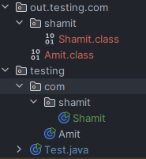
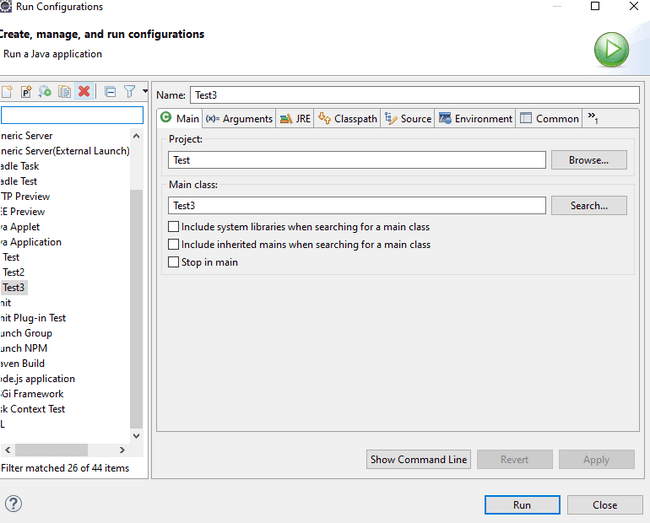
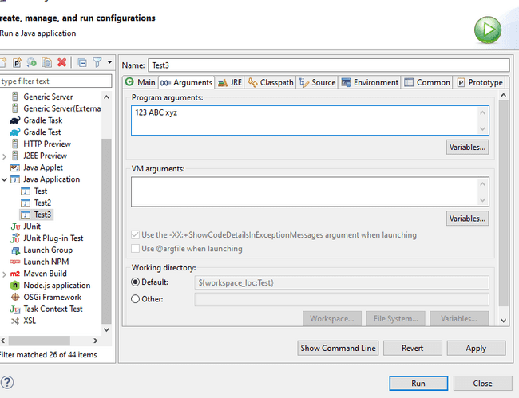

# Packages

Packages are an efficient way to organize Java classes. They are like directories and sub directories under which Java classes are organized systematically. Otherwise, there can be a naming conflict between classes with same name and it will really difficult to find our required classes. Java uses FQCN Fully qualified class name to find discrepancy between classes with same name

```java
public static void main(String[] args) {
    Date date = new Date();
    java.sql.Date date1 = new java.sql.Date(31312);
    System.out.println(date);
    System.out.println(date1);

}

```

Here java.sql.Date is the FQCN

Package example

```java
package testing.com;

public class Amit {
    public static void main(String[] args) {
        System.out.println("Hello World");
    }
}

```

Difference between package and directory is that package name must be added in the class and gives the context from where class can be loaded.

For example, from the folder where package testing exists, we can run

java .\testing\com\Amit.java

But taking package into consideration we can run like

javac .\testing\com\Amit.java   #compile

java testing.com.Amit#run

Package is also helpful when we import one class in one package to another package.

Suppose we have below folder structure for java files Amit.java and Shamit.java

src

|__testing

|__Amit.java

|__shamit

|__Shamit.java

```java
package testing.com;

public class Amit {
    public static void main(String[] args) {
        System.out.println("Hello World");
    }
}

package testing.com.shamit;

public class Shamit {
    Amit am = new Amit();
    public static void main(String[] args) {
        System.out.println("Hello Shamit");
    }
}

```

Notice since root package is testing, hence we know the context from where other classes can be loaded.

- In java11 we can run directly without compiling like java testing/com/Amit.java. This is called single-file source-code.

- But this will not work for Shamit.java i.e. java testing/com/shamit/Shamit.java which has reference to class Amit.

- So, we must compile first Amit class with javac testing/com/Amit.java then Shamit class with command java testing/com/shamit/Shamit.java

- Or we can compile Amit and Shamit class both with command javac testing/com/Amit.java testing/com/shamit/Shamit.java and then run java testing.com.shamit.Shamit from the folder where testing is present

Note Amit.java which doesn’t have any dependency on other file can be run as both **java saha/amit/Amit.java  or java saha.amit.Amit**. However, for Shamit has dependency on Amit. So, it must be compiled and known to Java

**Default class file folder**

By default the class files will be created next to .java files. If we want to keep our classes in a folder named “out” we have to use the -d option like **javac -d out testing/com/Amit.java testing/com/shamit/Shamit.java**. After -d we mention the path where we want to create the class files. In our case it will give the below structure.



**Running from other folders**

- We may not always be in the folder from where we are running our command. This is not a problem for Amit.java which is single file source code and can be run from anywhere using java command **java testing/com/Amit.java** by providing proper path.

- But classes like Shamit which must run from class files need to be on classpath which is the root from where the package is starting.  So, for Shamit we need to be inside the “out” folder and run  java testing.com.shamit.Shamit

- If we are ruining from location outside out we need to mention classpath or -cp option. java -cp .\out\ testing.com.shamit.Shamit.

- if we go outside my current folder named “JAVA”. Then the command will be java -cp .\java\out\ testing.com.shamit.Shamit

**Importing using ***

We can also import an entire package using * like below

```java
import java.util.*;

```

But this is not advisable as it will import all Classes in the package. Some say it will slow the compilation process however that is not true. But what it does is that since unwanted classes are imported it can create a conflict as two Classes. For e.g. In below class if we import entire java.util and java.sql then compiler won’t know which class to load. Plus it makes the code cluttered.

```java
import java.sql.*;
import java.util.*;

public class Amit {
public static void main(String[] args) {
```

Date date = new Date(0);  *//not compiling*

}

}

**FCQN**

If you want to use 2 classes with same name, you have to use FQCN fully qualified class name for 2nd class

```java
import java.util.Date;

public class Amit {
public static void main(String[] args) {
```

Date date = new Date();

java.sql.Date date2 = new java.sql.Date(0);

}

}

java.lang.* is by default included in all Java classes, hence we don’t need to import any class from java.lang like System.out.println

Static variables in java.lang has to qualified with class name for e.g.

```java
public static void main(String[] args) {
System.out.println();
```

Integer.parseInt("6");

}

Instead we can do Static import in that case we don’t gave to give class name before method call

```java
import static java.lang.Integer.*;
import static java.lang.System.*;

public class Amit {
public static void main(String[] args) {
```

out.println();

parseInt("6");

}

Only when two methods have same name we have to use Class.method name for 2nd implementation.

In order pass arguments while running Java program, open run configuration in eclipse.



Add arguments separated with space.



From CLI just pas the arguments after file name java Test.java 123 ABC

```java
public static void main(String[] args) {

if (args.length >0) {
```

Stream.of(args).forEach(s->{

```java
System.out.println("Your Args"+s);
```

});

} else {

```java
System.out.println("No Args passed");
```

}

}
