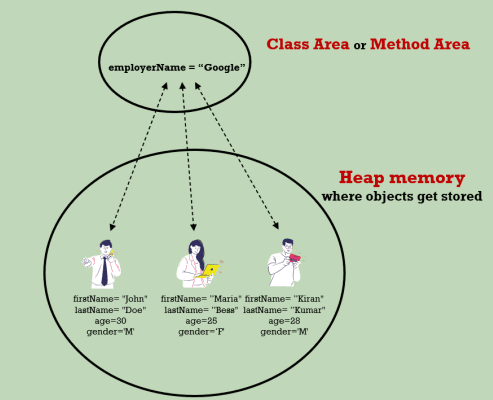

# Static

Static variables stored in method area. Whenever we try to create the static variables inside the Java classes, behind the scenes, all the static variables are going to be stored inside a memory called method area. This is an area inside the JVM memory which is going to be shared by all the threads. When we try to execute a Java program, JVM first loads the Java class into the memory, and it will look for any static variables that are present inside the class. If they are present, then they are going to initialize and store them inside the memory called method area class area and the static variables that we store inside these memories are going to be remain and available until the program terminates.

All the objects that we create inside the Java are going to be stored inside the heap memory. Whereas the static variables that we are going to create will be stored inside the method area or class area. So, if you try to create too many static variables inside your classes, it may cause out of memory error.



Static Block and methods can create objects instances but can’t access instance variables without creating instances

```java
public class Test {

    static {
        System.out.println("This is static block");
        Test test = new Test();
        System.out.println(test);
        //Can create object but can't access non static method or variables
    }
}

public class Test {

    int i;

    static {
        method1();
        //Can access static method also from static blocks
    }

    static void method1(){
        System.out.println("This is a static method");
        //can't access i or any non static variables or methods like i or method2 
    }

    void method2() {}

    public static void main(String[] args) {
        method1();
        Test.method1(); // access in both ways
    }
}

```

> 💡 **Note:** Static reference and creating objects in static block

```java
public class Test {

    static Test test;

    static {
        System.out.println(Test.test); //Here the object will be null
        Test.test = new Test();
    }

    public static void main(String[] args) {
        System.out.println(Test.test);
        //Here since it is already initiated in static block will have a valid reference
    }
}

```

> 💡 **Note:** Infinite loop

```java
public class Test {

    static Test test;

    {
        System.out.println(Test.test);
        Test.test = new Test();
    }

    public static void main(String[] args) {
        new Test();
        System.out.println(Test.test);
        //This will go in infinite recursive loop
    }
}

```
