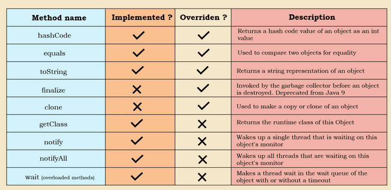

# Object Class



- **obj.getclass()**: This implementation of this method in Object class may look like a abstarct class but its not.

```java
@IntrinsicCandidate
public final native Class<?> getClass();

```

The Native implies that the implementation is in platform dependent native code like C or C++. The method is final so can’t be overwritten. It returns an object of class named Class in java. We can use it to get the FCQN, Class name , package etc.

```java
public static void main(String[] args) {
    String str = "ddds";
    Class aClass = str.getClass();
    System.out.println(aClass.getName());   //FCQN
    System.out.println(aClass.getPackage()); //Package
    System.out.println(aClass.getSimpleName()); //Class name
}
```

***lass name***

- **obj.hashCode():** Objective of this method is to create a hash value from the object on which it is applied. The default implementation will create a hash using the memory location of the object and will return integer. Like getClass this is also native so we can’t see the implementation.

```java
@IntrinsicCandidate
public native int hashCode();

```

- We can overwrite the hash code method, but we should follow some guidelines provided by Java in hashCode method documentation.

- If the equals method for 2 objects is returning true, then hash code of 2 objects should be same.

- If the hashCode for 2 objects are same, it doesn’t guarantee that the objects should be same, due to hash collisions.

- For same object in same execution enviornment like same machine, OS etc. the hashcode should be same

- When we are overriding the hashCode() we should also also override the toString() method also and the parameters used for calculating hashCode, same should be used for toString also

Example of overriding hashCode(). Note the hash() method is not from  java.lang.Object but java.util.Objects

```java
class Box {
    int height, breath, length;
    String colour;

    public Box(int height, int breath, int length, String colour) {
        this.height = height;
        this.breath = breath;
        this.length = length;
        this.colour = colour;
    }

    @Override
    public boolean equals(Object o) {
        if (o == null || getClass() != o.getClass()) return false;
        Box box = (Box) o;
        return height == box.height && breath == box.breath && length == box.length && Objects.equals(colour, box.colour);
    }

    @Override
    public int hashCode() {
        return Objects.hash(height, breath, length, colour);
    }
}

```

With above overritten code, the hashcode will be same for 2 objects with same value. But if we comment out the overridden custom implemntation it will be different which logically doesn’t make sence.

```java
public class Test {
    public static void main(String[] args) {
        Box b1 = new Box(2,2,2,"red");
        Box b2 = new Box(2,2,2,"red");
        System.out.println(b1.hashCode());
        System.out.println(b2.hashCode());
    }
}

```

- **equals()**: This method compares the euqality of 2 objects. The default implementation uses == operator so it comared the memory location of 2 objects

```java
public boolean equals(Object obj) {
    return (this == obj);
}

```

We can override the default behaviour. Sometimes default behaviour doesn’t make sence, say we have 2 objects of same person with same name, ssn etc. if we create 2 objects using new operator, then equals will treat them as different which is not correct. For example for the same Person example if we use default equals method, it will give false, which is logically not correct.

```java
public static void main(String[] args) {
    Box b1 = new Box(2,2,2,"red");
    Box b2 = new Box(2,2,2,"red");
    System.out.println(b1.hashCode());
    System.out.println(b2.hashCode());
    System.out.println(b1.equals(b2));
}
```

***false which is logically not correct***

We can use IDE like intellij to generate equals

```java
@Override
public boolean equals(Object o) {
    if (o == null || getClass() != o.getClass()) return false;
    Box box = (Box) o;
    return height == box.height && breath == box.breath && length == box.length && Objects.equals(colour, box.colour);
}

```

- **toString()**: Will return the Siring representation of the Class. Default implementation will give the classname appended with hex code represenatation of the hashcode

```java
public String toString() {
    return getClass().getName() + "@" + Integer.toHexString(hashCode());
}

```

We can override it to get more readable format.

- **finalize()**: The Java finalize() method of Object class is a method that the Garbage Collector always calls just before the deletion/destroying the object which is eligible for Garbage Collection to perform clean-up activity This is depricated and it should be left out to JVM for default garbage collection

- **clone()**: In Java when we use “=” operator it doesn’t create clone of existing object, rather both the objects refer to same memory location, so when we change one variable other also gets changed. To create a clone of an object we must use clone method provided in Object class which will create a new Object with same properties

*protected native* Object clone() *throws* CloneNotSupportedException;

This method is native and protected. To implement this the class has to implement marker interface Clonable and in overriding method just call the super implementation

With cloned object when we check hashCode and equals with default implemtation we see that hashcode is different for 2 objects and the equals also return false confirming that 2 different objects are created and if we change one other will not be changed.

```java
public class Test {
    public static void main(String[] args) throws CloneNotSupportedException {
        Box b1 = new Box(2, 2, 2, "red");
        Box b2 = b1.clone();
        b2.height = 44;
        System.out.println(b1.height);  //value of b1 is not changing

    }
}

class Box implements Cloneable {
    int height, breath, length;
    String colour;

    public Box(int height, int breath, int length, String colour) {
        this.height = height;
        this.breath = breath;
        this.length = length;
        this.colour = colour;
    }

    @Override
    public Box clone() throws CloneNotSupportedException {
        return (Box) super.clone();
    }
}

```

Let’s say we have one object having member variable as another Class object. Say Employee has a variable Person so when we create a clone of Employee the original and new object both will point to same person. So, changing Person of employee1 will change the peroson of emplyee2 which is clone or vice versa this is shallow cloning

```java
class BoxOwner{
    String name;

    public BoxOwner(String name) {
        this.name = name;
    }
}

class Box implements Cloneable {
    int height, breath, length;
    String colour;
    BoxOwner boxOwner;

    public Box(int height, int breath, int length, String colour, BoxOwner boxOwner) {
        this.height = height;
        this.breath = breath;
        this.length = length;
        this.colour = colour;
        this.boxOwner = boxOwner;
    }

    @Override
    public Box clone() throws CloneNotSupportedException {
        return (Box) super.clone();
    }
}

public class Test {
    public static void main(String[] args) throws CloneNotSupportedException {
        BoxOwner boxOwner = new BoxOwner("Amit");
        Box box = new Box(2, 2, 2, "red", boxOwner);
        Box box1 = box.clone();
        box1.height = 23;
        box1.boxOwner.name = "Shamit";
        //Same value of Box owner will be copied to both the classes
        System.out.printf("Box 1 properties height %d, owner %s%n", box.height, box.boxOwner.name);
        System.out.printf("Box 2 properties height %d, owner %s%n", box1.height, box1.boxOwner.name);
    }
}

```

So here we must do deep clone by cloning all the indivisula child objects we have to add clone menthod in Person and clone the person attribute of Employee this is deep clone

```java
class BoxOwner implements Cloneable{
    String name;

    public BoxOwner(String name) {
        this.name = name;
    }

    @Override
    public BoxOwner clone() throws CloneNotSupportedException {
        return (BoxOwner) super.clone();
    }
}

public class Test {
    public static void main(String[] args) throws CloneNotSupportedException {
        BoxOwner boxOwner = new BoxOwner("Amit");
        Box box = new Box(2, 2, 2, "red", boxOwner);
        Box box1 = box.clone();
        box1.height = 23;
        box1.boxOwner = boxOwner.clone();
        box1.boxOwner.name = "Shamit";
        //Both Box and box1 will have different values for boxOwner
        System.out.printf("Box 1 properties height %d, owner %s%n", box.height, box.boxOwner.name);
        System.out.printf("Box 2 properties height %d, owner %s%n", box1.height, box1.boxOwner.name);
    }
}

```

- wait
