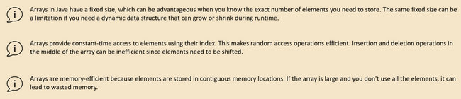
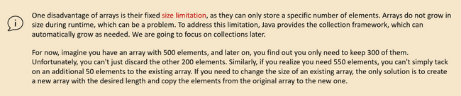

# Array

Array is a group of elements of similar data types. We can store primitives as well as objects in arrays. For e.g., here is a n integer array that can store 5 integer values in it.

```java
        int[] a = {90, 2,7,33,8};

```

Array in Java are objects. int[] a, here is an object that will point to memory location whose 1st element is 99. Since int takes 4 bytes Java can find the next location easily by knowing next elements. We access arrays using index of elements whhc start at 0 for 1st element and then 1,2,3,4 and so on.

Array declaration can be done in 3 ways

Initialization can be done in below ways

```java
int[] number;
int []number1;
int number2[];

```

The size of the array is fixed, which cannot be increased later.

Instead of looping through each element with for we can use For Each. It needs less boilerplate code but the problem is that we can’t get the index related operations as it doesn’t provide the index

```java
for (int i : number2) {
    System.out.println(i);
}

```

Array stores items in sequential order but if we are storing objects then they will be stored in heap in that case the arracy will hold the reference to the Heap object sequentially

Array advantage/Disadvantage





Array methods

```java
int[] oldArray = {1,2,3,4,5};
int[] targetArray = Arrays.copyOf(oldArray,3);      // Array method to create a copy of array
int[] targetArray1 = Arrays.copyOfRange(oldArray,1, 3);

for(int num:targetArray1) {
    System.out.println(num);
}

int[] nums = {1,2,3,4,5};
System.out.println("Array length "+nums.length);    // length

int[] smallArray = {5, 2,8,1,6};
Arrays.sort(smallArray);            // Array sort
System.out.println(Arrays.toString(smallArray));

int[] largerArray = new int[10000];
Random random = new Random();
for(int i=0;i<largerArray.length;i++){
    largerArray[i] = random.nextInt(1000000);
}
Arrays.parallelSort(largerArray);   // Use multiple tread can be used for very large arrays
System.out.println(Arrays.toString(largerArray));

int[] num = {36, 9, 42, 18, 73};
System.out.println(Arrays.toString(num));
Arrays.sort(num);
System.out.println(Arrays.toString(num));
int index = Arrays.binarySearch(num, 9);   // Search will work only with sorted array
//If we comment-out sort part it will return -1 which means not found
System.out.println(index);

```
