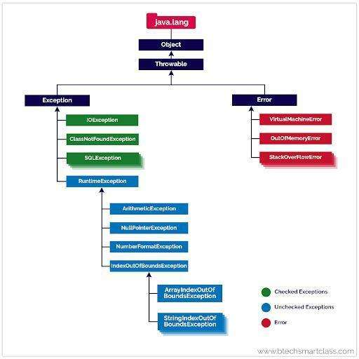

# Exception Hierarchy

Below is how exception is hierarchy is maintained.

- **Throwable** is the topmost class in Exception. Extended by Error and Exception class, Errors and exceptions are both types of throwable objects, but they represent different types of problems that can occur during the execution of a program.

- **Error:-** Errors are usually caused by serious problems that are outside the control of the program, such as running out of memory or a system crash. Errors are represented by the Error class and its subclasses. Some common examples of errors in Java include:

- OutOfMemoryError: Thrown when the Java Virtual Machine (JVM) runs out of memory.

- StackOverflowError: Thrown when the call stack overflows due to too many method invocations.

- NoClassDefFoundError: Thrown when a required class cannot be found.

Since errors are generally caused by problems that cannot be recovered from, it’s usually not appropriate for a program to catch errors. Instead, the best course of action is usually to log the error and exit the program.

- **Exception:** All exception come under Exception call

- **RuntimeException:**-> Those exceptions which under RuntimeException are unchecked exception i.e. Java won’t force you to handle it

- **Checked Exception:**  All exception under Exception which don’t fall under RuntimeException are checked exception i.e. Java will force you to handle it.
