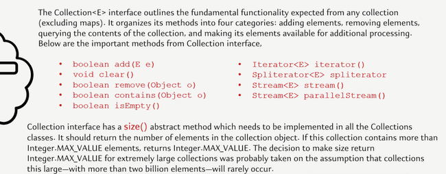
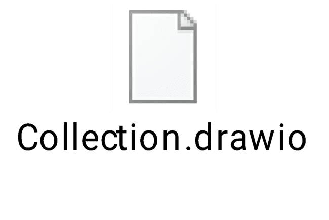
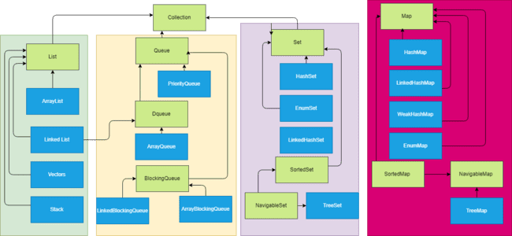
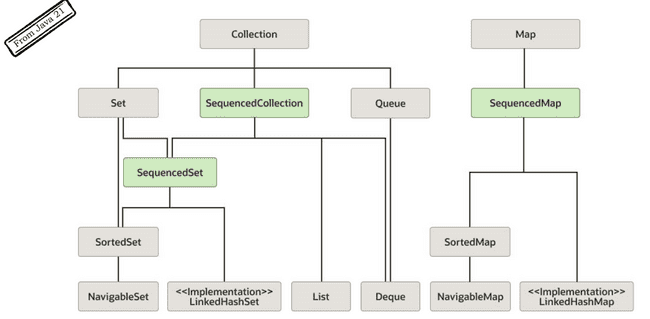
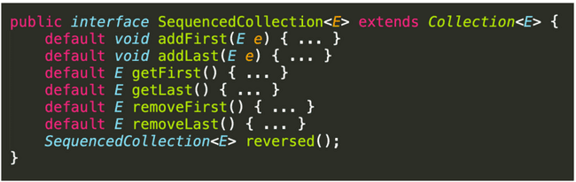
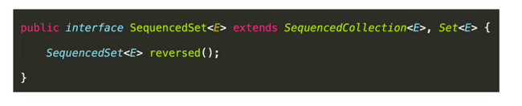
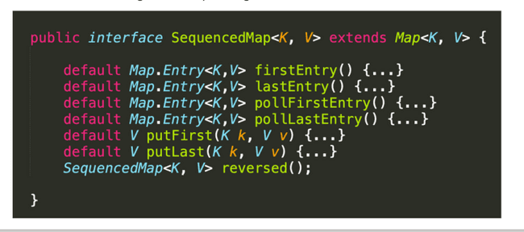

# Collections Overview

The Java collections framework provides various data structures and algorithms implementation to store and retrieve data. This has two main advantages:

We do not have to write code to implement these data structures and algorithms manually.

Our code will be much more efficient as the collections framework is highly optimised.

The Collections in Java is a framework that provides an architecture to store and manipulate the group of objects. Moreover, the collections framework allows us to use a specific data structure for a particular type of data. The Java collections framework provides a set of interfaces and classes to implement various data structures and algorithms.

People often get confused between the collections framework and Collection Interface.

- The Collection interface is the root interface of the collections framework

- Java does not provide direct implementations of the Collection interface but provides implementations of its sub interfaces like List, Set, and Queue

- There is another Collections class in util which provides utility methods



Hierarchy of the Collections framework. The java.util package contains all the classes and interfaces for the Collections framework.





Three interfaces are introduced from Java 21, These three interfaces are SequencedCollection, SequencedSet, and SequencedMap. Reson for introducing

- For all the data structures or the collection objects which maintain the order of insertion, they don't have a common parent or a common interface, which can be used by the developers to write some generic code using the data structures that maintain the order of insertion.

- The second reason why these interfaces are introduced is, in all the data structures or the collection objects, where they maintain the order of insertion, there is no uniform or consistent way to fetch the first element or the last element

- The third reason is there is no uniform or a proper or a direct way of reversing the elements inside the Collection object, or inside a data structure where the order of insertion is maintained



Since Set and map maintain different types of stucture we SequencedSet and SequencedMap was created along with SequencedCollection. They contain below methods Only reverse is abstarct method rest all are default methods which throws UnsupportedMethodException. Which means if the Class has not provided implementation for this it will throw exception.

SecquenceCollection methods



SequenceSet methods other methods are inherited from SequenceCollection



SequenceMap methods poll methods will remove the 1st item and



```java
public class SequenceTest {
    public static void main(String[] args) {
        SequencedMap<Integer, String> stringSequencedMap = new LinkedHashMap<>();
        Faker faker = new Faker();
        for (int i =0; i< 5;i++){
            stringSequencedMap.put(i,faker.gameOfThrones().character());
        }

        System.out.println(stringSequencedMap);
        System.out.println("<----------------");
        System.out.println(stringSequencedMap.reversed());
        System.out.println("<----------------");
        System.out.println(stringSequencedMap.pollFirstEntry());
        System.out.println(stringSequencedMap.pollLastEntry());
        System.out.println(stringSequencedMap.firstEntry());
        System.out.println(stringSequencedMap.lastEntry());
    }
}

```

The Collection interface includes various methods that can be used to perform different operations on objects. These methods are available in all its sub interfaces.

```java
int size();
```

boolean isEmpty();

boolean contains(Object o);

Iterator<E> iterator();

Object[] toArray();

<T> T[] toArray(T[] a);

default <T> T[] toArray(IntFunction<T[]> generator)

boolean add(E e);

boolean remove(Object o);

boolean containsAll(Collection<?> c);

boolean addAll(Collection<? extends E> c);

boolean removeAll(Collection<?> c);

default boolean removeIf(Predicate<? super E> filter)

boolean retainAll(Collection<?> c);

```java
void clear();
```

default Spliterator<E> spliterator()

default Stream<E> stream()

default Stream<E> parallelStream()
