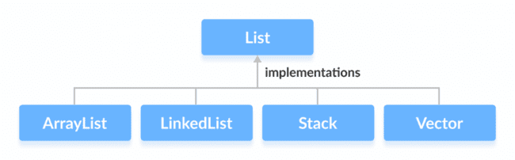
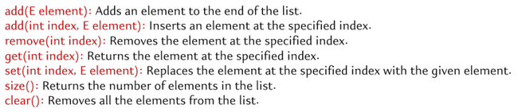
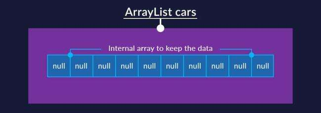
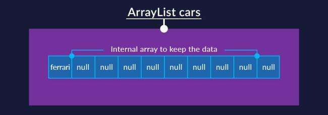
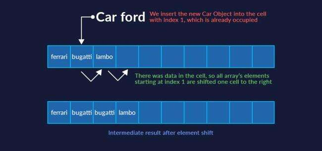
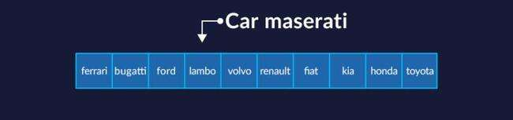
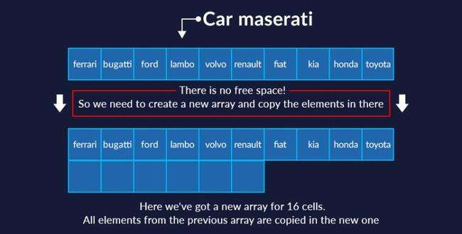

# List Interface

The List interface is an ordered collection that allows us to store and access elements sequentially. It allows duplicate

Since List is an interface, we cannot create objects from it. To use the functionalities of the List interface, we can use these classes:



List methods



### ArrayList

Array list stores sequential data. An ArrayList is a dynamic array implementation in Java that allows you to create resizable arrays. Unlike regular arrays, ArrayLists can dynamically grow and shrink in size, making them more flexible for handling collections of data. Resizing ArrayList involves creating new arrays and copying elements, which can be costly in terms of memory and performance. However, for most practical purposes, ArrayList provides satisfactory performance.

When to use array list?

- When needing ordered list based on index.

- Since it is indexed, accessing any element using index is faster so if we want frequent access it is better.

- When we don’t care about duplicate.

- Size of list is changing frequently.

- Arraylist is great when you want to do a lot of fetch operations since it is index based it fetches result faster. Its not good when you are doing a lot of insert and delete in the middle of List, since any addition or deletion in the middle will need to shift the entire list. Changes at the end are ok since we don’t ned to shift any element. Since most of the apps are heavy on read operation (like add and then read multiple times ) ArrayList is heavily used.

| initialised Array list<br>ArrayList<Car> cars = new ArrayList<>(); |  | ArrayList has an ordinary array inside, which acts as a data store. In most cases, we don't specify the exact size of the list. But the internal array must have some size! And so it does. Its default size is 10. |
| --- | --- | --- |
| cars.add(ferrari); |  | While adding elements the first order of business is to check whether the internal array has enough space in the internal array and whether one more element will fit. If there is space, then the new element is added to the end of the list. |
| cars.add(bugatti);<br>cars.add(lambo);<br>cars.add(1, ford) |  | if we insert in the middle, i.e. between other elements, first there is a check whether there is enough space in the array. If there is enough space, then the elements are shifted right, starting with the position where we're insert the new element. |
| if there are no places to insert new elements into the array. | <br> | a new array is created inside the ArrayList whose size is the size of the old array times 1.5 plus 1. In our case, the new array's size will be 16. All the current elements will be copied to there immediately.<br><br>The old array will be deleted by the garbage collector, and only the new, expanded array will remain. |
| al.remove(3); | <br> | removing elements makes "holes" in an array. The only way out was to shift items left with each removal, and we had to write our own code each time to perform this shift. |

Tips for array

- don't create an ArrayList with the default size if you're certain it will have at least 100 elements. The internal array

would have to be expanded **6 times** by the time you inserted the 100th element, and all the elements would have to be shifted each time.

from 10 elements to 16

from 16 elements to 25

from 25 to 38

from 38 to 58

from 58 to 88

from 88 to 133 (i.e. size of the old array times 1.5 plus 1)

As you can imagine, this is quite resource-intensive. So, if you already know (even approximately) the required number of items, it's better to create a list with an array of a specific size:

ArrayList<Car> cars = new ArrayList<>(100);

if you add elements more than 100 won’t cause array out of bound exception

- This strategy also has a flip side. **When you remove objects from an ArrayList, the internal array's size does not decrease automatically.** Suppose we have an ArrayList with a completely full internal array of 88 elements: As the program runs, we remove 77 elements, so only 11 remain: We're only using 11 positions here, but we've allocated memory for 88 elements. That's 8 times more than we need! In this case, we can optimise our memory use with one of the ArrayList class's special methods: **trimToSize()**. This method "trims" the length of the internal array down to the number of elements currently stored in it.

- To add an element use add(Object obj)

- To add an element at a specific position use add(i, Object obj).

- add(int index, E element) inserts item in arrayList shifting each element. For replacing item use set(int index, E element);

- clear()  is more efficient than removeAll()  while deleting.

- add(int index, E element) inserts item in arrayList shifting each element. For replacing item use set(int index, E element);

Accessing eleemnts of List

List items can be accessed in 3 ways

- **Using for loop**  It is simple and effective but we can’t do any index related operation like adding or modifying if we do it with foor loop it will throw exception.

```java
public class Test {

    public static void main(String[] args) {
        Faker faker = new Faker();
        List<String> list = new ArrayList<>();
        for (int i = 0; i < 10; i++) {
            list.add(faker.gameOfThrones().character());
        }
        for (String str : list ){
            System.out.println(str);
        }

        for (int i = 0; i < 10; i++) {
            list.remove(i);         //Will throw exception
        }
    }
}

```

- **Iterator**   It can be used to read the items in forward direction and we can read and delete items safely without any error. Itr.hasNext() will check for next item and itr.next() will move Iterator to next item.

Its mandatory to call itr.next() otherwise the iterator will not move and give illegal state exception

```java
public class Test {
    public static void main(String[] args) {
        Faker faker = new Faker();
        List<String> list = new ArrayList<>();
        for (int i = 0; i < 10; i++) {
            list.add(faker.gameOfThrones().character());
        }
        System.out.println(list);
        Iterator<String> itr = list.iterator();
        while (itr.hasNext()){     // Check next item
            System.out.println(itr.next()); // Moves iterator to next item
            itr.remove();      // Will remove item from list
        }
        System.out.println(list);   // Empty
    }
}

```

- **ListIterator** It can navigate the items in both forward and backward direaction and can modify items also

hasnext() and next() is for forward

hasPrevious() and previous() is for backward

It can also modify items with set method and also supports adding element

```java
public class Test {

    public static void main(String[] args) throws CloneNotSupportedException {
        Faker faker = new Faker();
        List<String> list = new ArrayList<>();
        for (int i = 0; i < 5; i++) {
            list.add(faker.gameOfThrones().character());
        }
        ListIterator<String> iterator = list.listIterator();
        while (iterator.hasNext()) {
            System.out.println(iterator.next());    // will print in forward directions
        }
        while (iterator.hasPrevious()) {             // will print in backward directions
            System.out.println(iterator.previous());
        }
    }
}

public class Test {
    static List<String> modify(List<String> list){
        Faker faker = new Faker();
        ListIterator<String> iterator = list.listIterator();
        while (iterator.hasNext()){
            iterator.next();
            iterator.set(faker.gameOfThrones().city());     // Will modify the list
        }
        return list;
    }
}

```

Altough listIterator provides a lot extra facility, but if we don’t need those features then it is better to stick to Iterator as ListIterator has some performance impact

Modifications of list

```java
public class Test {
    private static final Faker faker = new Faker();
    public static void main(String[] args) throws CloneNotSupportedException {
        List<String> list = new ArrayList<>();
        for (int i = 0; i < 5; i++) {
            list.add(faker.gameOfThrones().character());
        }
        System.out.println(list);   // Will print GOT character  name
        addJunk(list);
        System.out.println(list);   // Harry potter character names will get added
    }

    static void addJunk(List<String> lst) {
        lst.add(faker.harryPotter().character());
        lst.add(faker.harryPotter().character());
    }
}

```

To prevent this can use immutable list

```java
public class Test {
    private static final Faker faker = new Faker();
    public static void main(String[] args) throws CloneNotSupportedException {
        var newList = List.of(faker.gameOfThrones().character(),
                faker.gameOfThrones().character(),
                faker.gameOfThrones().character());
        System.out.println(newList);   // Will print GOT character  name
        addJunk(newList);              // throw UnsupportedOperationException as List is immutable
        System.out.println(newList);
    }

    static void addJunk(List<String> lst) {
        lst.add(faker.harryPotter().character());
        lst.add(faker.harryPotter().character());
    }
}

```

### LinkedList

A linked list is a linear data structure consisting of a sequence of elements, called nodes, where each node contains a data element and a reference (or pointer) to the next node in the sequence. Like array lists, linked lists do not have a fixed size, and the elements are not stored in contiguous memory locations. Instead, each element (node) points to the next element, forming a chain-like structure. Since it implements Deque interface also more details in Queue section

### Vectors

In Java, both ArrayList and Vector implement the List interface and provide the same functionalities. However, there exist some differences between them.

The Vector class synchronises each individual operation. This means whenever we want to perform some operation on vectors, the Vector class automatically applies a lock to that operation.

It is because when one thread is accessing a vector, and at the same time another thread tries to access it, an exception called ConcurrentModificationException is generated. Hence, this continuous use of lock for each operation makes vectors less efficient.

However, in array lists, methods are not synchronised. Instead, it uses the Collections.synchronizedList() method that synchronises the list as a whole.

why hasn't it been removed from Java yet? The fact is that Java professes the principle of backward compatibility. This means that all old code written many years ago will be understood by modern versions of Java.

### Stack

The Java collections framework has a class named Stack that provides the functionality of the stack data structure. The Stack class extends the Vector class. In stack, elements are stored and accessed in Last In First Out manner. That is, elements are added to the top of the stack and removed from the top of the stack. Since Stack extends the Vector class, it inherits all the methods of Vector or List like add, remove, set etc.. Besides these methods, the Stack class includes 5 more methods that distinguish it from Vector.

push()  To add an element to the top of the stack, we use the push() method.

pop() To remove an element from the top of the stack, we use the pop() method

peek()  The peek() method returns an object from the top of the stack

search() To search an element in the stack, we use the search() method. It returns the position of the element from the top of the stack.

empty() To check whether a stack is empty or not, we use the empty() method.

> 💡 **Note:** It is better to use stack specific method rather than List method when applicable

The Stack class provides the direct implementation of the stack data structure. However, it is recommended not to use it. Instead, use the ArrayDeque class (implements the Deque interface) to implement the stack data structure in Java.`
