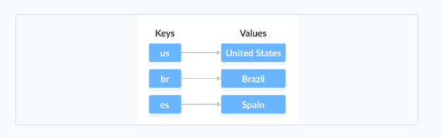
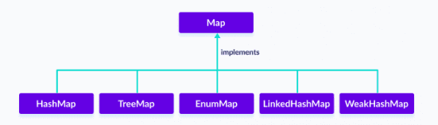
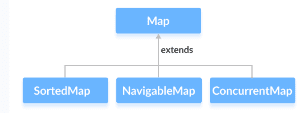
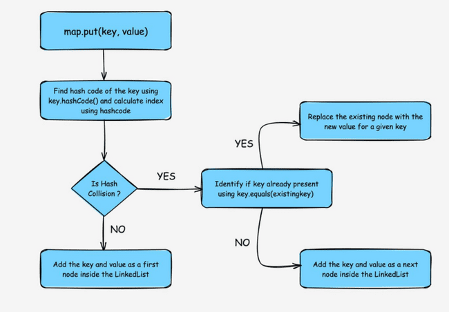
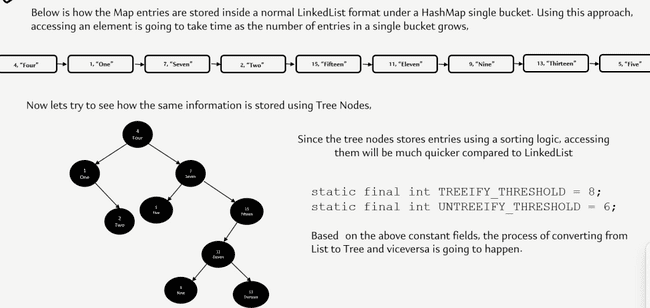
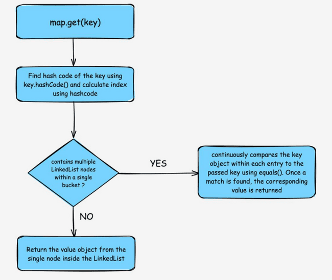
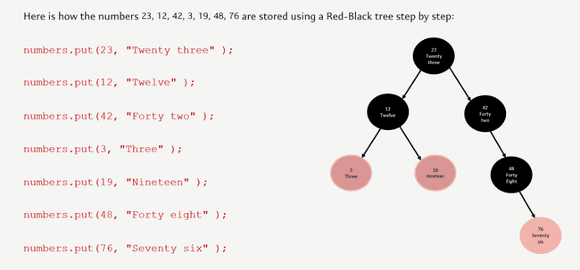

# Map

In Java, elements of Map are stored in key/value pairs. Keys are unique values associated with individual Values. A map cannot contain duplicate keys. And, each key is associated with a single value.



We can access and modify values using the keys associated with them.

In order to use the functionalities of the Map interface, we can use below Classes



The Map interface is also extended by these subinterfaces:



the Map interface also includes the following methods:

- **put(K, V)** - Inserts the association of a key K and a value V into the map. If the key is already present, the new value replaces the old value.

- **putAll()** - Inserts all the entries from the specified map to this map.

- **putIfAbsent(K, V)** - Inserts the association if the key K is not already associated with the value V.

- **get(K)** - Returns the value associated with the specified key K. If the key is not found, it returns null.

- **getOrDefault(K, defaultValue)** - Returns the value associated with the specified key K. If the key is not found, it returns the defaultValue.

- **containsKey(K)** - Checks if the specified key K is present in the map or not.

- **containsValue(V)** - Checks if the specified value V is present in the map or not.

- **replace(K, V)** - Replace the value of the key K with the new specified value V.

- **replace(K, oldValue, newValue)** - Replaces the value of the key K with the new value newValue only if the key K is associated with the value oldValue.

- **remove(K)** - Removes the entry from the map represented by the key K.

- **remove(K, V)** - Removes the entry from the map that has key K associated with value V.

- **keySet()** - Returns a set of all the keys present in a map.

- **values()** - Returns a set of all the values present in a map.

- **entrySet()** - Returns a set of all the key/value mapping present in a map.

Some important items

- Map is part of Collection framework but not collection interface

- Map is parameterized with 2 values Map<K, V>

- Each item of map is an Entry and is denoted by *interface* Entry<K, V>  mentioned in side Map interface

### HashMap

It stores elements in key/value pairs. Here, keys are unique identifiers used to associate each value on a map. A map cannot contain duplicate keys. And, each key is associated with a single value.

```java
// hashMap creation with 8 capacity and 0.6 load factor
HashMap<?, ?> map = new HashMap<>();

```

To add a single element to the hashmap, we use the put(), there is no add method like List interface.

```java
public class Test {
    public static void main(String[] args) {
        Map<String, String> map = new HashMap<>();
        map.put("india", "Delhi");
        map.put("usa", "Washington");
        map.put("australia", "Canberra");
    }
}

```

- Hashmaps store data in an array format where each data element, referred to as a ‘bucket’, holds the key-value pairs.

- Hash function is critical for determining the index in the array where a particular key-value pair will be stored. The hash function takes a key and returns an integer, which is then used to calculate the index. Hence order is not maintained in Hashmap as order is determined by the index of hash value calculated.

```java
public class Test {
    public static void main(String[] args) {
        Map<String, String> map = new HashMap<>();
        map.put("india", "Delhi");
        map.put("usa", "Washington");
        map.put("australia", "Canberra");
        System.out.println(map);        //not maintaining order of insertions
        System.out.println("usa".hashCode() + " | " + "australia".hashCode() + " | " + "india".hashCode());
        System.out.println(map.get("india"));
    }
}

```

- Not thread safe. Collections.synchronizedMap is used to make them syscronized.

```java
public class Test {
    public static void main(String[] args) {
        Map<String, String> map = new HashMap<>();
        Map<String, String> map1 = Collections.synchronizedMap(map);
    }
}

```

- In Hashmap collision happen when 2 or more keys produce same hashcode. Ideally key should be unique, but due to finite range of hash codes and potentially infinite no keys, collisions can happen.

- In case of collision HashMap uses equals method to determine if the Objects are same or not

- If equals returns true then previous value is removed from the index  and the new Object is added at the same index with the same key. So, for e.g. if Obj1 and Obj2 have same hash and true in equals method then the element added later say Obj2 will replace Obj1

- During collision if the equals method returns false then the 2 objects are considered as different then Map uses linked list to store Entry with same hash in same bucket



Since java 8 improvements have been done to solve hash collision. Linked list are not good for accessing large no of items So when no of collision is more than a specific threshold instead of using LinkedList it uses TreeMap

```java
static final int TREEIFY_THRESHOLD = 8;
static final int UNTREEIFY_THRESHOLD = 6;

```



- To retrieving items from Map we use get mothod and pass the key map.get("abc"). It generates the hash simmilay way like storing to figure out the bucket where the item is stored to fetch the result. And in case of collision follows the same equals method to eliminate the duplicates



We can retrieve result from Hash map in multiple ways

- Approach1  Using keys- We can get a set of keys using keyset() method and iterate over it to get items from map using get method by passing the key

- Approach2  Using entry- Each item in a HashMap is called Entry defined in a inner interface *interface* `Entry<K, v>` We can use entrySet() method to retrieve a set of Entry `Set<Map.Entry<K, v>>`

- Approach3  Retirve values usinsg values()  and  keySet() methods

```java
public class Test {
    public static void main(String[] args) {
        Map<String, String> map = new HashMap<>();
        map.put("india", "Delhi");
        map.put("usa", "Washington");
        map.put("australia", "Canberra");
        approach1(map);
        approach2(map);
        approach3(map);

    }

    public static void approach1(Map<String, String> countryMap) {
        Set<String> keys = countryMap.keySet();
        Iterator<String> iterator = keys.iterator();
        while (iterator.hasNext()) {
            String key = iterator.next();
            String value = countryMap.get(key);
            System.out.println(key + " : " + value);
        }
    }

    public static void approach2(Map<String, String> countryMap) {
        Set<Map.Entry<String, String>> entries = countryMap.entrySet();
        Iterator<Map.Entry<String, String>> iterator = entries.iterator();
        for (Map.Entry<String, String> entry : entries) {
            String key = entry.getKey();
            String value = entry.getValue();
            System.out.println(key + " : " + value);
        }
    }

    public static void approach3(Map<String, String> countryMap) {
        Collection<String> values = countryMap.values();
        Collection<String> keySet = countryMap.keySet();
        System.out.println(values);
        System.out.println(keySet);
        for (String key : keySet) {
            System.out.println("Key: "+ key+ ", Value: "+countryMap.get(key));
        }
    }
}

```

We can Change HashMap Value We can use the replace() method to change the value associated with a key in a hashmap.

Remove HashMap Elements To remove elements from a hashmap, we can use the remove() method.

Other Methods of HashMap

- **clear()**removes all mappings from the HashMap

- **compute()**computes a new value for the specified key

- **computeIfAbsent()**computes value if a mapping for the key is not present

- **computeIfPresent()**computes a value for mapping if the key is present

- **merge()**merges the specified mapping to the HashMap

- **clone()**makes the copy of the HashMap

- **containsKey()**checks if the specified key is present in Hashmap

- **containsValue()**checks if Hashmap contains the specified value

- **size()**returns the number of items in HashMap

- **isEmpty()**checks if the Hashmap is empty

### SortedMap Interface

The SortedMap interface of the Java collections framework provides sorting of keys stored in a map.

Since SortedMap is an interface, we cannot create objects from it.

In order to use the functionalities of the SortedMap interface, we need to use the class TreeMap that implements it.

Methods of SortedMap

The SortedMap interface includes all the methods of the Map interface. It is because Map is a super interface of SortedMap.

Besides all those methods, here are the methods specific to the SortedMap interface.

- **comparator()** - returns a comparator that can be used to order keys in a map

- **firstKey()** - returns the first key of the sorted map

- **lastKey()** - returns the last key of the sorted map

- **headMap(key)** - returns all the entries of a map whose keys are less than the specified key

- **tailMap(key)** - returns all the entries of a map whose keys are greater than or equal to the specified key

- **subMap(key1, key2)** - returns all the entries of a map whose keys lies in between key1 and key2 including key1

#### NavigableMap Interface

The NavigableMap interface of the Java collections framework provides the features to navigate among the map entries. It is considered as a type of SortedMap.In order to use the functionalities of the NavigableMap interface, we need to use the TreeMap class that implements NavigableMap.

The NavigableMap is considered as a type of SortedMap. It is because NavigableMap extends the SortedMap interface.Hence, all SortedMap methods are also available in NavigableMap. To learn how these methods are defined in SortedMap, visit Java SortedMap.However, some of the methods of SortedMap (headMap(), tailMap(), and subMap() ) are defined differently in NavigableMap.

**headMap(key, booleanValue)** The headMap() method returns all the entries of a navigable map associated with all those keys before the specified key (which is passed as an argument). The booleanValue is an optional parameter. Its default value is false. If true is passed as a booleanValue, the method returns all the entries associated with all those keys before the specified key, including the entry associated with the specified key.

**tailMap(key, booleanValue)** The tailMap() method returns all the entries of a navigable map associated with all those keys after the specified key (which is passed as an argument) including the entry associated with the specified key. The booleanValue is an optional parameter. Its default value is true. If false is passed as a booleanValue, the method returns all the entries associated with those keys after the specified key, without including the entry associated with the specified key.

**subMap(k1, bv1, k2, bv2)** The subMap() method returns all the entries associated with keys between k1 and k2 including the entry associated with k1. The bv1 and bv2 are optional parameters. The default value of bv1 is true and the default value of bv2 is false. If false is passed as bv1, the method returns all the entries associated with keys between k1 and k2, without including the entry associated with k1. If true is passed as bv2, the method returns all the entries associated with keys between k1 and k2, including the entry associated with k1.

Other Methods

The NavigableMap provides various methods that can be used to locate the entries of maps.

- descendingMap() - reverse the order of entries in a map

- descendingKeyMap() - reverses the order of keys in a map

- ceilingEntry() - returns an entry with the lowest key among all those entries whose keys are greater than or equal to the specified key

- ceilingKey() - returns the lowest key among those keys that are greater than or equal to the specified key

- floorEntry() - returns an entry with the highest key among all those entries whose keys are less than or equal to the specified key

- floorKey() - returns the highest key among those keys that are less than or equal to the specified key

- higherEntry() - returns an entry with the lowest key among all those entries whose keys are greater than the specified key

- higherKey() - returns the lowest key among those keys that are greater than the specified key

- lowerEntry() - returns an entry with the highest key among all those entries whose keys are less than the specified key

- lowerKey() - returns the highest key among those keys that are less than the specified key

- firstEntry() - returns the first entry (the entry with the lowest key) of the map

- lastEntry() - returns the last entry (the entry with the highest key) of the map

- pollFirstEntry() - returns and removes the first entry of the map

- pollLastEntry() - returns and removes the last entry of the map

#### TreeMap

The TreeMap class in Java is a part of the Java Collections Framework and provides an efficient way to store key-value pairs in a sorted order based on the natural ordering of its keys or by a custom comparator. It implements the NavigableMap interface. The map is sorted according to the natural ordering of its keys, or by a Comparator provided at map creation time, depending on which constructor is used.

> 💡 **Note:** TreeMap  NavigableMap SortedMap  Map

How TreeMap stores data



Insert Elements to TreeMap

put() - inserts the specified key/value mapping (entry) to the map

putAll() - inserts all the entries from specified map to this map

putIfAbsent() - inserts the specified key/value mapping to the map if the specified key is not present in the map

Access TreeMap Elements

1. Using entrySet(), keySet() and values()

- entrySet() - returns a set of all the key/values mapping (entry) of a treemap

- keySet() - returns a set of all the keys of a tree map

- values() - returns a set of all the maps of a tree map

- get() - Returns the value associated with the specified key. Returns null if the key is not found.

- getOrDefault() - Returns the value associated with the specified key. Returns the specified default value if the key is not found.

Remove TeeMap Elements

- remove(key) - returns and removes the entry associated with the specified key from a TreeMap

- remove(key, value) - removes the entry from the map only if the specified key is associated with the specified value and returns a boolean value

Replace TreeMap Elements

- replace(key, value) - replaces the value mapped by the specified key with the new value

- replace(key, old, new) - replaces the old value with the new value only if the old value is already associated with the specified key

- replaceAll(function) - replaces each value of the map with the result of the specified function

Methods for Navigation

Since the TreeMap class implements NavigableMap, it provides various methods to navigate over the elements of the treemap.

1. First and Last Methods

firstKey() - returns the first key of the map

firstEntry() - returns the key/value mapping of the first key of the map

lastKey() - returns the last key of the map

lastEntry() - returns the key/value mapping of the last key of the map

Ceiling, Floor, Higher and Lower Methods

- higherKey() - Returns the lowest key among those keys that are greater than the specified key.

- higherEntry() - Returns an entry associated with a key that is lowest among all those keys greater than the specified key.

- lowerKey() - Returns the greatest key among all those keys that are less than the specified key.

- lowerEntry() - Returns an entry associated with a key that is greatest among all those keys that are less than the specified key.

- ceilingKey() - Returns the lowest key among those keys that are greater than the specified key. If the key passed as an argument is present in the map, it returns that key.

- ceilingEntry() - Returns an entry associated with a key that is lowest among those keys that are greater than the specified key. It an entry associated with the key passed an argument is present in the map, it returns the entry associated with that key.

- floorKey() - Returns the greatest key among those keys that are less than the specified key. If the key passed as an argument is present, it returns that key.

- floorEntry() - Returns an entry associated with a key that is greatest among those keys that are less than the specified key. If the key passed as argument is present, it returns that key.

- pollFirstEntry() and pollLastEntry() Methods

- pollFirstEntry() - returns and removes the entry associated with the first key of the map

- pollLastEntry() - returns and removes the entry associated with the last key of the map

4. headMap(), tailMap() and subMap() Methods

headMap(key, booleanValue)

The headMap() method returns all the key/value pairs of a treemap before the specified key (which is passed as an argument).

The booleanValue parameter is optional. Its default value is false.

If true is passed as a booleanValue, the method also includes the key/value pair of the key which is passed as an argument.

tailMap(key, booleanValue)

The tailMap() method returns all the key/value pairs of a treemap starting from the specified key (which is passed as an argument). The booleanValue is an optional parameter. Its default value is true. If false is passed as a booleanValue, the method doesn't include the key/value pair of the specified key.

subMap(k1, bV1, k2, bV2)

The subMap() method returns all the entries associated with keys between k1 and k2 including the entry of k1. The bV1 and bV2 are optional boolean parameters. The default value of bV1 is true and the default value of bV2 is false. If false is passed as bV1, the method returns all the entries associated with keys between k1 and k2 without including the entry of k1. If true is passed as bV2, the method returns all the entries associated with keys between k1 and k2 including the entry of k2.

```java
public class Test {
    public static void main(String[] args) {
        Faker faker = new Faker();
        TreeMap<Integer, String> map = new TreeMap<>();
        for (int i = 10; i >= 1; i--) {
            map.put(i, faker.superhero().name());
        }
        System.out.println(map);  // Sorted by keys even though insert was reversed from 10 to 1
        System.out.println(map.tailMap(4,true));
    }
}

```

### LinkedHashMap

The LinkedHashMap class of the Java collections framework provides the hash table and linked list implementation of the Map interface.

The LinkedHashMap interface extends the HashMap class to store its entries in a hash table. It internally maintains a doubly-linked list among all of its entries to order its entries.

LinkedHashMap Vs. HashMap

Both the LinkedHashMap and the HashMap implements the Map interface. However, there exist some differences between them.

LinkedHashMap maintains a doubly-linked list internally. Due to this, it maintains the insertion order of its elements.

The LinkedHashMap class requires more storage than HashMap. This is because LinkedHashMap maintains linked lists internally.

> 💡 **Note:** The performance of LinkedHashMap is slower than HashMap.

```java
public class Test {
    public static void main(String[] args) {
        Faker faker = new Faker();
        LinkedHashMap<Integer, String> map = new LinkedHashMap<>();
        for (int i = 10; i >= 1; i--) {
            map.put(i, faker.superhero().name());
        }
        System.out.println(map);  // Order maintained 
    }
}

```

### WeakHashMap

The object of a weak reference type can be garbage collected in Java if the reference is no longer used in the program.

Differences Between HashMap and WeakHashMap

Let us see the implementation of a weak hashmap in Java.

```java
public class Test {
    public static void main(String[] args) {
        // Creating WeakHashMap of numbers
        WeakHashMap<String, Integer> numbers = new WeakHashMap<>();

        String two = new String("Two");
        Integer twoValue = 2;
        String four = new String("Four");
        Integer fourValue = 4;

        // Inserting elements
        numbers.put(two, twoValue);
        numbers.put(four, fourValue);
        System.out.println("WeakHashMap: " + numbers);

        // Make the reference null
        two = null;

        // Perform garbage collection
        System.gc();

        System.out.println("WeakHashMap after garbage collection: " + numbers);
    }

}

```

[Run Code](https://www.programiz.com/java-programming/online-compiler)

**O**utput

WeakHashMap: {Four=4, Two=2}

WeakHashMap after garbage collection: {Four}

As we can see, when the key two of a weak hashmap is set to null and perform garbage collection, the key is removed.

It is because unlike hashmaps, keys of weak hashmaps are of **weak reference** type. This means the entry of a map are removed by the garbage collector if the key to that entry is no longer used. This is useful to save resources.

Now let us see the same implementation in a hashmap.

[Run Code](https://www.programiz.com/java-programming/online-compiler)

Output

HashMap: {Four=4, Two=2}

HashMap after garbage collection: {Four=4, Two=2}

Here, when the key two of the hashmap is set to null and perform garbage collection, the key is not removed.

This is because unlike weak hashmaps keys of hashmaps are of **strong reference** type. This means the entry of a map is not removed by the garbage collector even though the key to that entry is no longer used.

**Note**: All functionalities of hashmaps and weak hashmaps are similar except keys of a weak hashmap are of weak reference, whereas keys of a hashmap are of strong reference.

### EnumMap

The EnumMap class of the Java collections framework provides a map implementation for elements of an enum.

In EnumMap, enum elements are used as keys. It implements the Map interface.

Insert Elements to EnumMap

put() - inserts the specified key/value mapping (entry) to the enum map

putAll() - inserts all the entries of a specified map to this map

For example,

```java
public class Test {
    enum Size {
        SMALL, MEDIUM, LARGE, EXTRA_LARGE
    }

    public static void main(String[] args) {

        // Creating an EnumMap of the Size enum
        EnumMap<Size, Integer> sizes1 = new EnumMap<>(Size.class);
        // Using the put() Method
        sizes1.put(Size.SMALL, 28);
        sizes1.put(Size.MEDIUM, 32);
        System.out.println("EnumMap1: " + sizes1);

        EnumMap<Size, Integer> sizes2 = new EnumMap<>(Size.class);

        // Using the putAll() Method
        sizes2.putAll(sizes1);
        sizes2.put(Size.LARGE, 36);
        sizes2.put(Size.EXTRA_LARGE, 42);
        System.out.println("EnumMap2: " + sizes2);

        EnumMap<Size, Integer> m = new EnumMap<>(Size.class);
        m.put(Size.LARGE, Size.LARGE.ordinal());
        System.out.println(m);
    }
}

```

### ConcurrentMap Interface

The ConcurrentMap interface of the Java collections framework provides a thread-safe map. That is, multiple threads can access the map at once without affecting the consistency of entries in a map.

ConcurrentMap is known as a synchronized map.

The ConcurrentMap interface includes all the methods of the Map interface. It is because Map is the super interface of the ConcurrentMap interface.

Besides all those methods, here are the methods specific to the ConcurrentMap interface.

putIfAbsent() - Inserts the specified key/value to the map if the specified key is not already associated with any value.

compute() - Computes an entry (key/value mapping) for the specified key and its previously mapped value.

computeIfAbsent() - Computes a value using the specified function for the specified key if the key is not already mapped with any value.

computeIfPresent() - Computes a new entry (key/value mapping) for the specified key if the key is already mapped with the specified value.

forEach() - Access all entries of a map and perform the specified actions.

merge() - Merges the new specified value with the old value of the specified key if the key is already mapped to a certain value. If the key is not already mapped, the method simply associates the specified value to our key.

#### ConcurrentHashMap

The ConcurrentHashMap class of the Java collections framework provides a thread-safe map. That is, multiple threads can access the map at once without affecting the consistency of entries in a map. It implements the ConcurrentMap interface.
