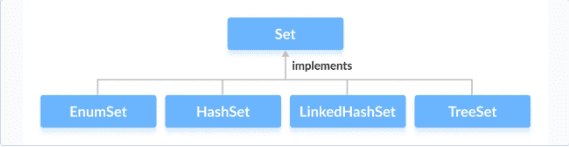
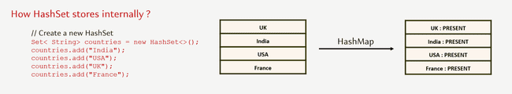
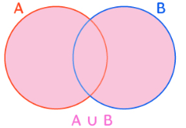
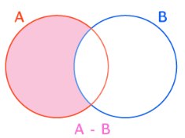
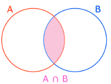
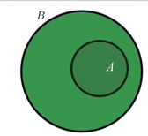
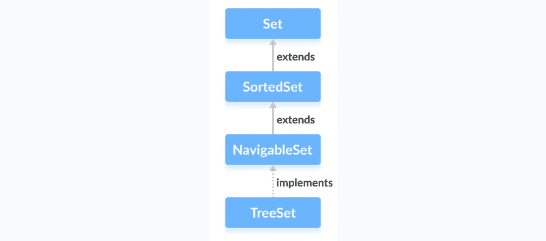

# Set Interface

The Set interface allows us to store elements in different sets like the set in mathematics. It cannot have duplicate elements. Since Set is an interface, we cannot create objects from it. To use functionalities of the Set interface, we can use these classes:



The Set interface is also extended by these sub interfaces:


The Java Set interface allows us to perform basic mathematical set operations like union, intersection, and subset.

- Union

- Intersection

- Difference

- Subset

Set usually doesn’t maintain order of insertions but some implementations do that like LinkedHashSet. But the primary objective of Set is to remove duplicate element

We can create Set from list which will remove any duplicate items

```java
ArrayList<String> list = new ArrayList<>();
HashSet<String> hashSet = new HashSet<>(list);

```

### HashSet

The HashSet class of the Java Collections framework provides the functionalities of the hash table data structure. HashSet also going to work with the principle of hashing mechanism and hash tables. Whenever we are trying to provide an element to the HashSet,

- First it is going to calculate the hash code of the element.

- If there is an element already with the same hash code inside the hash table, then it is going to leverage the equals() method to compare the new element with the existing one, which has the same hash code.

- If the equals() method returns true, then it means we are trying to add a duplicate element into the Set so it will be discarded.

- If the equals() method returns false, in such scenarios, the new element is going to be added under the same bucket in an linked list format or in a tree mapper format, because there are multiple elements with the same hash code. So it is going to work very similar to HashMap.

If we see the constructor of HashSet we will see that it internally uses HashMap

```java
public HashSet() {
    map = new HashMap<>();
}

```

Also, if we see the add method of HashSet it just adds to hashMap with the key as our input value and the Value parameter as a constant called PRESENT

```java
public boolean add(E e) {
    return map.put(e, PRESENT)==null;
}

```



```java
// HashSet with 8 capacity and 0.75 load factor
HashSet<Integer> numbers = new HashSet<>(8, 0.75f);

```

Notice, the part new HashSet<>(8, 0.75). Here, the first parameter is capacity, and the second parameter is loadFactor.

capacity - The capacity of this hash set is 8. Meaning, it can store 8 elements.

loadFactor - The load factor of this hash set is 0.75. This means, whenever our hash set is filled by 75%, the elements are moved to a new hash table of double the size of the original hash table.

By default, the capacity of the hash set will be 16 the load factor will be 0.75

In Java, HashSet is commonly used if

- Remove duplicate

- Do Set operations like Union, Intersection, Subset etc.

- we have to access elements randomly. It is because elements in a hash table are accessed using hash codes. The hashcode of an element is a unique identity that helps to identify the element in a hash table. HashSet cannot contain duplicate elements. Hence, each hash set element has a unique hashcode.

HashSet relies on the hashCode and equals method to determine unique objects. For custom class we can override hashCode() and equals method to determine unique objects

```java
class Employee {
    int salary;
    int age;

    public Employee(int salary, int age) {
        super();
        this.salary = salary;
        this.age = age;
    }

    @Override
    public int hashCode() {
        return Objects.hash(age);
    }

    @Override
    public boolean equals(Object obj) {
        if (this == obj)
            return true;
        if (obj == null)
            return false;
        if (getClass() != obj.getClass())
            return false;
        Employee other = (Employee) obj;
        return age == other.age;
    }

    @Override
    public String toString() {
        return "Employee [salary=" + salary + ", age=" + age + "]";
    }
}

```

HashSet don’t have any get method so we rely on Iterator or for each to fetch items

```java
public class Test {
    public static void main(String[] args) {
        Set<String> superpowers = new HashSet<>();
        superpowers.add("Invisibility");
        superpowers.add("Teleportation");
        superpowers.add("Mind Reading");

        for (String superPower : superpowers) {
            System.out.println(superPower.toUpperCase());
        }
        Iterator<String> iterator = superpowers.iterator();

        while (iterator.hasNext()) {
            String superPower = iterator.next();
            System.out.println(superPower.toLowerCase());
        }
    }
}

```

Set provides a lot of operations provided by mathematical set like

| Union | addAll |  |
| --- | --- | --- |
| Difference | removeAll |  |
| Intersection | retainAll |  |
| Subset | containsAll |  |

```java
public class Test {
    public static void main(String[] args) {

        Set<Integer> hashSet1 = new HashSet<>(List.of(1, 2, 3, 4, 5));
        Set<Integer> hashSet2 = new HashSet<>(List.of(4, 5, 6, 7, 8));

        hashSet1.addAll(hashSet2);                      // Union
        System.out.println("Union " + hashSet1);        // Union [1, 2, 3, 4, 5, 6, 7, 8]

        hashSet1 = new HashSet<>(List.of(1, 2, 3, 4, 5));
        hashSet1.retainAll(hashSet2);                   // Intersection
        System.out.println("Intersection" + hashSet1);  // Intersection[4, 5]

        hashSet1 = new HashSet<>(List.of(1, 2, 3, 4, 5));
        hashSet1.removeAll(hashSet2);                   // Difference
        System.out.println("Difference" + hashSet1);    // Difference[1, 2, 3]

        // Subset
        hashSet1 = new HashSet<>(List.of(1, 2, 3, 4, 5));
        hashSet2 = new HashSet<>(List.of(1, 2, 3));
        boolean isSubSet = hashSet1.containsAll(hashSet2);
        System.out.println("Subset " + isSubSet);         //Subset true
    }
}

```

### Enum Set

The EnumSet class of the Java collections framework provides a set implementation of elements of a single enum. Unlike other set implementations, the enum set does not have public constructors. We must use the predefined methods to create an enum set like allOf , noneOf, range, of

```java
public class Test {
    public static void main(String[] args) {

        EnumSet<Size> sizes = EnumSet.allOf(Size.class);
        System.out.println("EnumSet: " + sizes);

        sizes = EnumSet.noneOf(Size.class);
        System.out.println("Empty EnumSet: " + sizes);

        sizes = EnumSet.range(Size.MEDIUM, Size.EXTRALARGE);
        System.out.println("EnumSet: " + sizes);

        EnumSet<Size> sizes2 = EnumSet.of(Size.SMALL, Size.LARGE);
        System.out.println("EnumSet2: " + sizes2);

        sizes2.add(Size.EXTRALARGE);
    }
}

enum Size {
    SMALL, MEDIUM, LARGE, EXTRALARGE
}

```

The EnumSet provides an efficient way to store Enum values than other set implementations (like HashSet, TreeSet). An Enum set only stores Enum values of a specific Enum. Hence, the JVM already knows all the possible values of the set. This is the reason why Enum sets are internally implemented as a sequence of bits. Bits specifies whether elements are present in the Enum set or not. The bit of a corresponding element is turned on if that element is present in the set.

### LinkedHashSet

The LinkedHashSet class of the Java collections framework provides functionalities of both the hashtable and the linked list data structure.  Elements of LinkedHashSet are stored in hash tables similar to HashSet. However, linked hash sets maintain a doubly-linked list internally for all of its elements. The linked list defines the order in which elements are inserted in hash tables.

```java
public class Test {
    public static void main(String[] args) {
        // LinkedHashSet with 8 capacity and 0.75 load factor
        LinkedHashSet<Integer> numbers = new LinkedHashSet<>(8, 0.75);

        // LinkedHashSet with default capacity and load factor
        LinkedHashSet<Integer> numbers1 = new LinkedHashSet<>();
    }
}

```

LinkedHashSet Vs. HashSet

Both LinkedHashSet and HashSet implements the Set interface. However, there exist some differences between them.

- LinkedHashSet maintains a linked list internally. Due to this, it maintains the insertion order of its elements.

- The LinkedHashSet class requires more storage than HashSet. This is because LinkedHashSet maintains linked lists internally.

- The performance of LinkedHashSet is slower than HashSet. It is because of linked lists present in LinkedHashSet.

### SortedSet

The SortedSet interface of the Java collections framework is used to store elements with some order in a set.In order to use the functionalities of the SortedSet interface, we need to use the TreeSet class that implements it.



The SortedSet interface includes all the methods of the Set interface. It's because Set is a super interface of SortedSet.

Besides methods included in the Set interface, the SortedSet interface also includes these methods:

comparator() - returns a comparator that can be used to order elements in the set

first() - returns the first element of the set

last() - returns the last element of the set

headSet(element) - returns all the elements of the set before the specified element

tailSet(element) - returns all the elements of the set after the specified element including the specified element

subSet(element1, element2) - returns all the elements between the element1 and element2 including element1

#### NavigableSet

The NavigableSet interface of the Java Collections framework provides the features to navigate among the set elements. In order to use the functionalities of the NavigableSet interface, we need to use the TreeSet class that implements NavigableSet.

In order to use the functionalities of the NavigableSet interface, we need to use the TreeSet class that implements NavigableSet.

The NavigableSet is considered as a type of SortedSet. It is because NavigableSet extends the SortedSet interface. Hence, all SortedSet methods are also available in NavigableSet. To learn how these methods, visit Java SortedSet. However, some of the methods of SortedSet (headSet(), tailSet() and subSet()) are defined differently in NavigableSet.

Let's see how these methods are defined in NavigableSet.

**headSet(element, booleanValue)** -The headSet() method returns all the elements of a navigable set before the specified element (which is passed as an argument). The booleanValue parameter is optional. Its default value is false. If true is passed as a booleanValue, the method returns all the elements before the specified element including the specified element.

**tailSet(element, booleanValue)** The tailSet() method returns all the elements of a navigable set after the specified element (which is passed as an argument) including the specified element. The booleanValue parameter is optional. Its default value is true. If false is passed as a booleanValue, the method returns all the elements after the specified element without including the specified element.

**subSet(e1, bv1, e2, bv2)** The subSet() method returns all the elements between e1 and e2 including e1. The bv1 and bv2 are optional parameters. The default value of bv1 is true, and the default value of bv2 is false. If false is passed as bv1, the method returns all the elements between e1 and e2 without including e1. If true is passed as bv2, the method returns all the elements between e1 and e2, including e1.

Methods for Navigation

The NavigableSet provides various methods that can be used to navigate over its elements.

descendingSet() - reverses the order of elements in a set

descendingIterator() - returns an iterator that can be used to iterate over a set in reverse order

ceiling() - returns the lowest element among those elements that are greater than or equal to the specified element

floor() - returns the greatest element among those elements that are less than or equal to the specified element

higher() - returns the lowest element among those elements that are greater than the specified element

lower() - returns the greatest element among those elements that are less than the specified element

pollFirst() - returns and removes the first element from the set

pollLast() - returns and removes the last element from the set

#### TreeSet

The TreeSet class of the Java collections framework provides the functionality of a tree data structure.

In order to create a tree set, we must import the java.util.TreeSet package first. Once we import the package, here is how we can create a TreeSet in Java.

TreeSet<Integer> numbers = new TreeSet<>();

Here, we have created a TreeSet without any arguments. In this case, the elements in TreeSet are sorted naturally (ascending order). However, we can customize the sorting of elements by using the Comparator interface.

Insert Elements to TreeSet

add() - inserts the specified element to the set

addAll() - inserts all the elements of the specified collection to the set

Remove Elements

remove() - removes the specified element from the set

removeAll() - removes all the elements from the set

Methods for Navigation

Since the TreeSet class implements NavigableSet, it provides various methods to navigate over the elements of the tree set.

1. first() and last() Methods

first() - returns the first element of the set

last() - returns the last element of the set

Other methods

higher(element) - Returns the lowest element among those elements that are greater than the specified element.

lower(element) - Returns the greatest element among those elements that are less than the specified element.

ceiling(element) - Returns the lowest element among those elements that are greater than the specified element. If the element passed exists in a tree set, it returns the element passed as an argument.

floor(element) - Returns the greatest element among those elements that are less than the specified element. If the element passed exists in a tree set, it returns the element passed as an argument.

pollFirst() - returns and removes the first element from the set

pollLast() - returns and removes the last element from the set

headSet(element, booleanValue) The headSet() method returns all the elements of a tree set before the specified element (which is passed as an argument). The booleanValue parameter is optional. Its default value is false. If true is passed as a booleanValue, the method returns all the elements before the specified element including the specified element.

tailSet(element, booleanValue) The tailSet() method returns all the elements of a tree set after the specified element (which is passed as a parameter) including the specified element. The booleanValue parameter is optional. Its default value is true. If false is passed as a booleanValue, the method returns all the elements after the specified element without including the specified element.

subSet(e1, bv1, e2, bv2) The subSet() method returns all the elements between e1 and e2 including e1. The bv1 and bv2 are optional parameters. The default value of bv1 is true, and the default value of bv2 is false. If false is passed as bv1, the method returns all the elements between e1 and e2 without including e1. If true is passed as bv2, the method returns all the elements between e1 and e2, including e1.

Set Operations

The methods of the TreeSet class can also be used to perform various set operations.

- To perform the union between two sets, we use the addAll() method.

```java
public class Test {
    public static void main(String[] args) {
        TreeSet<Integer> evenNumbers = new TreeSet<>();
        evenNumbers.add(2);
        evenNumbers.add(4);
        System.out.println("TreeSet1: " + evenNumbers);

        TreeSet<Integer> numbers = new TreeSet<>();
        numbers.add(1);
        numbers.add(2);
        numbers.add(3);
        System.out.println("TreeSet2: " + numbers);

        // Union of two sets
        numbers.addAll(evenNumbers);
        System.out.println("Union is: " + numbers);
    }
}

```

- To perform the intersection between two sets, we use the retainAll() method

```java
public class Test {
    public static void main(String[] args) {
        TreeSet<Integer> evenNumbers = new TreeSet<>();
        evenNumbers.add(2);
        evenNumbers.add(4);
        System.out.println("TreeSet1: " + evenNumbers);

        TreeSet<Integer> numbers = new TreeSet<>();
        numbers.add(1);
        numbers.add(2);
        numbers.add(3);
        System.out.println("TreeSet2: " + numbers);

        // Intersection of two sets
        numbers.retainAll(evenNumbers);
        System.out.println("Intersection is: " + numbers);
    }
}

```

- To calculate the difference between the two sets, we can use the removeAll() method.

```java
public class Test {
    public static void main(String[] args) {
        TreeSet<Integer> evenNumbers = new TreeSet<>();
        evenNumbers.add(2);
        evenNumbers.add(4);
        System.out.println("TreeSet1: " + evenNumbers);

        TreeSet<Integer> numbers = new TreeSet<>();
        numbers.add(1);
        numbers.add(2);
        numbers.add(3);
        numbers.add(4);
        System.out.println("TreeSet2: " + numbers);

        // Difference between two sets
        numbers.removeAll(evenNumbers);
        System.out.println("Difference is: " + numbers);
    }
}

```

- To calculate the difference between the two sets, we can use the removeAll() method.

```java
public class Test {
    public static void main(String[] args) {
        TreeSet<Integer> numbers = new TreeSet<>();
        numbers.add(1);
        numbers.add(2);
        numbers.add(3);
        numbers.add(4);
        System.out.println("TreeSet1: " + numbers);

        TreeSet<Integer> primeNumbers = new TreeSet<>();
        primeNumbers.add(2);
        primeNumbers.add(3);
        System.out.println("TreeSet2: " + primeNumbers);

        // Check if primeNumbers is subset of numbers
        boolean result = numbers.containsAll(primeNumbers);
        System.out.println("Is TreeSet2 subset of TreeSet1? " + result);
    }
}

```

Other Methods of TreeSet

clone()Creates a copy of the TreeSet

contains()Searches the TreeSet for the specified element and returns a boolean result

isEmpty()Checks if the TreeSet is empty

size()Returns the size of the TreeSet

clear()Removes all the elements from the TreeSet

TreeSet Vs. HashSet

Both the TreeSet as well as the HashSet implements the Set interface. However, there exist some differences between them.

- Unlike HashSet, elements in TreeSet are stored in some order. It is because TreeSet implements the SortedSet interface as well.

- TreeSet provides some methods for easy navigation. For example, first(), last(), headSet(), tailSet(), etc. It is because TreeSet also implements the NavigableSet interface.

- HashSet is faster than the TreeSet for basic operations like add, remove, contains and size.

Differences between LinkedHashSet and TreeSet:

- The TreeSet class implements the SortedSet interface. That's why elements in a tree set are sorted. However, the LinkedHashSet class only maintains the insertion order of its elements.

- A TreeSet is usually slower than a LinkedHashSet. It is because whenever an element is added to a TreeSet, it has to perform the sorting operation.

- LinkedHashSet allows the insertion of null values. However, we cannot insert a null value to TreeSet.

TreeSet Comparator

In all the examples above, tree set elements are sorted naturally. However, we can also customize the ordering of elements. For this, we need to create our own comparator class based on which elements in a tree set are sorted
