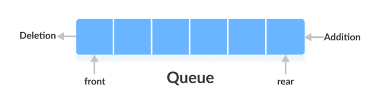
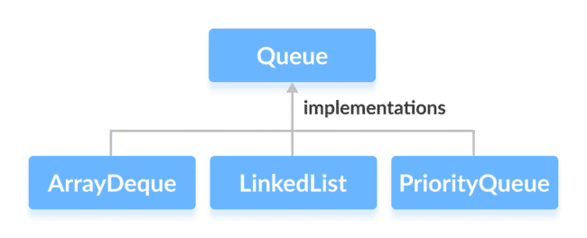
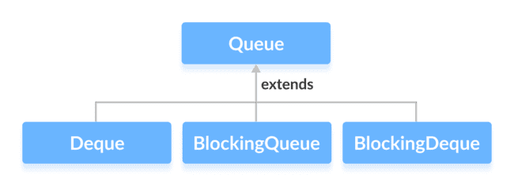
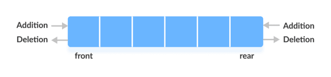
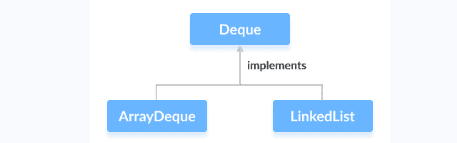
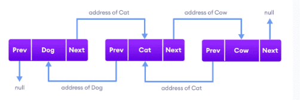
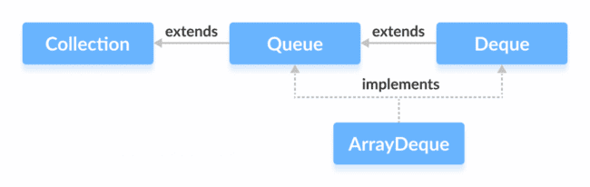

# Queue Interface

The Queue interface of the Java collections framework provides the functionality of the queue data structure. In queues, elements are stored and accessed in First In, First Out manner. That is, elements are added from the behind and removed from the front. Since the Queue is an interface, In order to use the functionalities of Queue, we need to use classes that implement it:





The Queue interface is also extended by various sub interfaces:



Key Characteristics and Features:

**FIFO Ordering:**

Elements are added at the "rear" (tail) and removed from the "front" (head), adhering to the First-In, First-Out principle.

**No Random Access:**

Unlike List implementations, Queue does not provide direct access to elements by index.

**Dynamic Size:**

Queues can automatically adjust their capacity as elements are added or removed.

**Specialized Methods:**

The Queue interface defines specific methods for adding, removing, and inspecting elements. For each operation, there are typically two versions: one that throws an exception if the operation fails (e.g., add(), remove(), element()) and another that returns a special value (e.g., offer(), poll(), peek()) to indicate success or failure without throwing an exception.

Some methods of queue interface

add() - Inserts the specified element into the queue. If the task is successful, add() returns true, if not it throws an exception.

offer() - Inserts the specified element into the queue. If the task is successful, offer() returns true, if not it returns false.

element() - Returns the head of the queue. Throws an exception if the queue is empty.

peek() - Returns the head of the queue. Returns null if the queue is empty.

remove() - Returns and removes the head of the queue. Throws an exception if the queue is empty.

poll() - Returns and removes the head of the queue. Returns null if the queue is empty.

### PriorityQueue

The PriorityQueue class provides the functionality of theheap data structure. Internally, PriorityQueue uses a binary heap to efficiently manage the elements and ensure that the element with the highest priority (or lowest value in a min-heap, which is the default) is always at the head of the queue.

Unlike normal queues, priority queue elements are retrieved in sorted order.

Suppose, we want to retrieve elements in the ascending order.

- In this case, the head of the priority queue will be the smallest element.

- Once this element is retrieved, the next smallest element will be the head of the queue.

It is important to note that the elements of a priority queue may not be sorted. However, elements are always retrieved in sorted order. We can customise the ordering of elements with the help of the Comparator interface.

**Insert** Elements to PriorityQueue

add() - Inserts the specified element to the queue. If the queue is full, it throws an exception.

offer() - Inserts the specified element to the queue. If the queue is full, it returns false.

To access elements from a priority queue, we can use the peek() method. This method returns the head of the queue.

Remove PriorityQueue Elements

remove() - removes the specified element from the queue

poll() - returns and removes the head of the queue

Other PriorityQueue Methods

contains(element)Searches the priority queue for the specified element. If the element is found, it returns true, if not it returns false.

size()Returns the length of the priority queue.

toArray()Converts a priority queue to an array and returns it.

```java
public class Test {
    public static void main(String[] args) {
        PriorityQueue<String> pq = new PriorityQueue<>();
        pq.add("Hello");
        pq.add("World");
        pq.add("Amit");

        System.out.println(pq.poll()+ pq.poll()+ pq.poll());
    }
}

```

### Deque Interface

The Deque interface of the Java collections framework provides the functionality of a double-ended queue. In a regular queue, elements are added from the rear and removed from the front. However, in a deque, we can insert and remove elements from both front and rear.





addFirst() - Adds the specified element at the beginning of the deque. Throws an exception if the deque is full.

addLast() - Adds the specified element at the end of the deque. Throws an exception if the deque is full.

offerFirst() - Adds the specified element at the beginning of the deque. Returns false if the deque is full.

offerLast() - Adds the specified element at the end of the deque. Returns false if the deque is full.

getFirst() - Returns the first element of the deque. Throws an exception if the deque is empty.

getLast() - Returns the last element of the deque. Throws an exception if the deque is empty.

peekFirst() - Returns the first element of the deque. Returns null if the deque is empty.

peekLast() - Returns the last element of the deque. Returns null if the deque is empty.

removeFirst() - Returns and removes the first element of the deque. Throws an exception if the deque is empty.

removeLast() - Returns and removes the last element of the deque. Throws an exception if the deque is empty.

pollFirst() - Returns and removes the first element of the deque. Returns null if the deque is empty.

pollLast() - Returns and removes the last element of the deque. Returns null if the deque is empty

The Stack(LIFO last in first out) class of the Java Collections framework provides the implementation of the stack. However, it is recommended to use Deque as a stack instead of the Stack class. It is because methods of Stack are synchronized. Here are the methods the Deque interface provides to implement stack:

push() - adds an element at the beginning of deque

pop() - removes an element from the beginning of deque

peek() - returns an element from the beginning of deque

#### LinkedList

It provides the functionality of the linked list data structure (doubly linkedlist). E ach element in a linked list is known as a node. It consists of 3 fields:

Prev - stores an address of the previous element in the list. It is null for the first element

Next - stores an address of the next element in the list. It is null for the last element

Data - stores the actual data

Working of a Java LinkedList

Elements in linked lists are not stored in sequence. Instead, they are scattered and connected through links (Prev and Next).



Since the LinkedList class also implements the Queue and the Deque interface, it can implement methods of these interfaces as well. Here are some of the commonly used methods:

MethodsDescriptions

addFirst()adds the specified element at the beginning of the linked list

addLast()adds the specified element at the end of the linked list

getFirst()returns the first element

getLast()returns the last element

removeFirst()removes the first element

removeLast()removes the last element

peek()returns the first element (head) of the linked list

poll()returns and removes the first element from the linked list

offer()adds the specified element at the end of the linked list

Both the Java ArrayList and LinkedList implements the List interface of the Collections framework. However, there exists some difference between them.

| LinkedList | ArrayList |
| --- | --- |
| Implements List, Queue, and Deque interfaces. | Implements List interface. |
| Stores 3 values (previous address, data, and next address) in a single position. | Stores a single value in a single position. |
| Provides the doubly-linked list implementation. | Provides a resizable array implementation. |
| Whenever an element is added, prev and next address are changed. | Whenever an element is added, all elements after that position are shifted. |
| To access an element, we need to iterate from the beginning to the element. | Can randomly access elements using indexes. |
|  |  |
|  |  |

#### ArrayDeque

The ArrayDeque class implements these two interfaces: It provide access to both end of the Queue, since it implements Dequeue also

Java Queue Interface

Java Deque Interface



**Add elements** using add(), addFirst() and addLast()

**Insert elements** using offer(), offerFirst() and offerLast()

**Access elements** using getFirst() and getLast()

**Access elements** using peek(), peekFirst() and peekLast() method

peek() - returns the first element of the array deque

peekFirst() - returns the first element of the array deque (equivalent to peek())

peekLast() - returns the last element of the array deque

**Remove elements** using the remove(), removeFirst(), removeLast() method

**Remove elements** using the poll(), pollFirst() and pollLast() method

poll() - returns and removes the first element of the array deque

pollFirst() - returns and removes the first element of the array deque (equivalent to poll())

pollLast() - returns and removes the last element of the array deque

ArrayDeque as a Stack

To implement a LIFO (Last-In-First-Out) stacks in Java, it is recommended to use a deque over the Stack class. The ArrayDeque class is likely to be faster than the Stack class.

ArrayDeque provides the following methods that can be used for implementing a stack.

push() - adds an element to the top of the stack

peek() - returns an element from the top of the stack

pop() - returns and removes an element from the top of the stack

ArrayDeque Vs. LinkedList Class

Both ArrayDeque and Java LinkedList implements the Deque interface. However, there exist some differences between them.

LinkedList supports null elements, whereas ArrayDeque doesn't.

Each node in a linked list includes links to other nodes. That's why LinkedList requires more storage than ArrayDeque.

If you are implementing the queue or the deque data structure, an ArrayDeque is likely to faster than a LinkedList.

### BlockingQueue

BlockingQueue interface of the Java Collections framework extends the Queue interface. It allows any operation to wait until it can be successfully performed. For example, if we want to delete an element from an empty queue, then the blocking queue allows the delete operation to wait until the queue contains some elements to be deleted.

Classes that Implement BlockingQueue

ArrayBlockingQueue

LinkedBlockingQueue

Methods of BlockingQueue

add() - Inserts an element to the blocking queue at the end of the queue. Throws an exception if the queue is full.

element() - Returns the head of the blocking queue. Throws an exception if the queue is empty.

remove() - Removes an element from the blocking queue. Throws an exception if the queue is empty.

offer() - Inserts the specified element to the blocking queue at the end of the queue. Returns false if the queue is full.

peek() - Returns the head of the blocking queue. Returns null if the queue is empty.

poll() - Removes an element from the blocking queue. Returns null if the queue is empty.

The BlockingQueue also provides methods to block the operations and wait if the queue is full or empty.

put() - Inserts an element to the blocking queue. If the queue is full, it will wait until the queue has space to insert an element.

take() - Removes and returns an element from the blocking queue. If the queue is empty, it will wait until the queue has elements to be deleted.

Suppose, we want to insert elements into a queue. If the queue is full then the put() method will wait until the queue has space to insert elements.

Similarly, if we want to delete elements from a queue. If the queue is empty then the take() method will wait until the queue contains elements to be deleted.

Why BlockingQueue?

In Java, BlockingQueue is considered as the thread-safe collection. It is because it can be helpful in multi-threading operations.

Suppose one thread is inserting elements to the queue and another thread is removing elements from the queue.

Now, if the first thread runs slower, then the blocking queue can make the second thread wait until the first thread completes its operation.

#### ArrayBlockingQueue

provides the blocking queue implementation using an array.

put() and take() Method

In multithreading processes, we can use put() and take() to block the operation of one thread to synchronize it with another thread. These methods will wait until they can be successfully executed.

Why use ArrayBlockingQueue?

The ArrayBlockingQueue uses arrays as its internal storage.

It is considered as a thread-safe collection. Hence, it is generally used in multi-threading applications.

Suppose, one thread is inserting elements to the queue and another thread is removing elements from the queue.

Now, if the first thread is slower than the second thread, then the array blocking queue can make the second thread waits until the first thread completes its operations.

#### LinkedBlockingQueue

The LinkedBlockingQueue class of the Java Collections framework provides the blocking queue implementation using a linked list.

Methods of LinkedBlockingQueue

The LinkedBlockingQueue class provides the implementation of all the methods in the BlockingQueue interface. These methods are used to insert, access and delete elements from linked blocking queues. Also, we will learn about two methods put() and take() that support the blocking operation in the linked blocking queue. These two methods distinguish the linked blocking queue from other typical queues.

Insert Elements

add() - Inserts a specified element to the linked blocking queue. It throws an exception if the queue is full.

offer() - Inserts a specified element to the linked blocking queue. It returns false if the queue is full.

Access Elements

peek() - Returns an element from the front of the linked blocking queue. It returns null if the queue is empty.

iterator() - Returns an iterator object to sequentially access an element from the linked blocking queue. It throws an exception if the queue is empty. We must import the java.util.Iterator package to use it.

Remove Elements

remove() - Returns and removes a specified element from the linked blocking queue. It throws an exception if the queue is empty.

poll() - Returns and removes a specified element from the linked blocking queue. It returns null if the queue is empty.

clear() - Removes all the elements from the linked blocking queue.

put() and take() Methods

In multithreading processes, we can use put() and take() to block the operation of one thread to synchronize it with another thread. These methods will wait until they can be successfully executed.

put() Method

To insert the specified element to the end of a linked blocking queue, we use the put() method.

If the linked blocking queue is full, it waits until there is space in the linked blocking queue to insert the element.

take() Method

To return and remove an element from the front of the linked blocking queue, we can use the take() method.

If the linked blocking queue is empty, it waits until there are elements in the linked blocking queue to be deleted.

Why use LinkedBlockingQueue?

The LinkedBlockingQueue uses linked lists as its internal storage.

It is considered as a thread-safe collection. Hence, it is generally used in multi-threading applications.

Suppose, one thread is inserting elements to the queue and another thread is removing elements from the queue.

Now, if the first thread is slower than the second thread, then the linked blocking queue can make the second thread waits until the first thread completes its operations.
