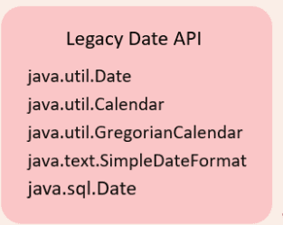
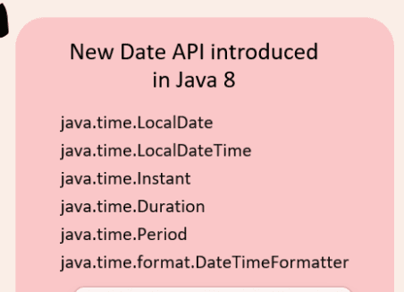

# Date Time Overview

Inside Java, there are two different distinct APIs that we can use to represent date and time values.

- Api in **java.util** and **java.sql** package  Legacy API e.g

- API in **java.time** package introduced in Java 8 as on improvement over legacy API

Issues with legacy API

- Ambiguity  Date represents both date and time. We can't store date and time as a two separate objects types.

Date date = *new* Date();

- Legacy Date API starts with 1900. So if I want to print 18th December 2024 we have to write like below

Date date = *new* Date(124,11,18);System.out.println(date);   ***//Wed Dec 18 00:00:00 IST 2024***

So we have to pass 124 for year 1900+ 124 for 2014

11 for December as index starts from 0

Also midnight time is returned by default

- Mutable not thread safe, new API is immutable hence thread safe.

- Precision only till milliseconds new date API supports Instant class which supports nanoseconds

- All the different time zones and daylight savings is not handled properly and is error prone

- Although different date formats like mm/dd/yy , dd/mm/yyyy etc. is handelled by SimpleDateFormat class in legacy API it is verbose and error prone
