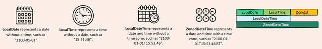

# Modern Date-Time API (`java.time`)

Java 8 introduced the `java.time` package (JSR-310). Its core design principles are:

1. **Immutability & Thread Safety**: All core classes are immutable and thread-safe. Any modification method returns a new instance.
2. **Clear Separation of Concerns**: Distinct classes for human-readable dates, times, combined date-times, machine timestamps, durations, and timezones.
3. **Fluent API**: Consistent method naming prefixes (`of`, `now`, `from`, `with`, `plus`, `minus`, `at`, `to`, `is`).



---

## 1. Core Local Classes

- **`LocalDate`**: Date without time or timezone (e.g., `2024-12-18`).
- **`LocalTime`**: Time without date or timezone with nanosecond precision (e.g., `14:30:15.123456789`).
- **`LocalDateTime`**: Combines date and time without timezone (e.g., `2024-12-18T14:30:15`).
- **`ZonedDateTime`**: Date and time with a full timezone and DST rules (e.g., `2024-12-18T14:30:15+05:30[Asia/Kolkata]`).

```java
import java.time.*;

LocalDate date = LocalDate.now();
LocalTime time = LocalTime.now();
LocalDateTime dateTime = LocalDateTime.now();
ZonedDateTime zonedDateTime = ZonedDateTime.now();

System.out.println(date);          // 2024-12-18
System.out.println(time);          // 14:30:15.964948500
System.out.println(dateTime);      // 2024-12-18T14:30:15.964948500
System.out.println(zonedDateTime);  // 2024-12-18T14:30:15.964948500+05:30[Asia/Kolkata]
```

---

## 2. Instantiating Specific Values (`of` methods)

```java
import java.time.LocalDate;
import java.time.LocalDateTime;
import java.time.LocalTime;
import java.time.Month;

// LocalDate using int or Month enum
LocalDate d1 = LocalDate.of(2024, 12, 18);
LocalDate d2 = LocalDate.of(2024, Month.DECEMBER, 18);

// LocalTime with hours, minutes, seconds, nanos
LocalTime t1 = LocalTime.of(14, 30);
LocalTime t2 = LocalTime.of(14, 30, 45, 500_000_000);

// LocalDateTime combining components
LocalDateTime dt1 = LocalDateTime.of(2024, Month.DECEMBER, 18, 14, 30);
LocalDateTime dt2 = LocalDateTime.of(d1, t1);

// Utility factory methods
LocalDate epochDay = LocalDate.ofEpochDay(1000);       // 1000 days after 1970-01-01
LocalDate dayOfYear = LocalDate.ofYearDay(2024, 100);  // 100th day of 2024
```

---

## 3. Querying Information (`get` methods)

```java
LocalDate date = LocalDate.of(2024, Month.DECEMBER, 18);

int year          = date.getYear();          // 2024
Month month       = date.getMonth();         // Month.DECEMBER
int monthVal      = date.getMonthValue();    // 12 (1-based, no +1 required!)
int dayOfMonth    = date.getDayOfMonth();    // 18
DayOfWeek dayWeek = date.getDayOfWeek();     // DayOfWeek.WEDNESDAY
boolean isLeap    = date.isLeapYear();       // true
```

---

## 4. Modifying Values (`with` methods)

Because `java.time` classes are immutable, `with` methods return a modified copy:

```java
LocalDateTime original = LocalDateTime.of(2024, Month.DECEMBER, 18, 14, 30);

// Modify individual fields
LocalDateTime newYear  = original.withYear(2030);
LocalDateTime newMonth = original.withMonth(5);
LocalDateTime chained  = original.withYear(2030).withMonth(5).withDayOfMonth(1);

System.out.println(original); // 2024-12-18T14:30 (unchanged)
System.out.println(chained);  // 2030-05-01T14:30
```

---

## 5. Combining and Converting (`at` and `to` methods)

- **`at...`**: Creates a higher-level or supplemented type by adding missing information.
- **`to...`**: Extracts a lower-level component from a composite object.

```java
LocalDate date = LocalDate.of(2024, 12, 18);

// Add time to LocalDate to get LocalDateTime
LocalDateTime startOfDay = date.atStartOfDay();      // 2024-12-18T00:00
LocalDateTime withTime   = date.atTime(18, 45);      // 2024-12-18T18:45

// Extract components from LocalDateTime
LocalDateTime dt = LocalDateTime.of(2024, 12, 18, 18, 45);
LocalDate extractedDate = dt.toLocalDate();          // 2024-12-18
LocalTime extractedTime = dt.toLocalTime();          // 18:45
```

---

## 6. Date Arithmetic (`plus` & `minus`)

```java
LocalDate date = LocalDate.of(2024, 3, 18);

LocalDate plusDays   = date.plusDays(6);     // 2024-03-24
LocalDate plusWeeks  = date.plusWeeks(2);    // 2024-04-01
LocalDate plusMonths = date.plusMonths(6);   // 2024-09-18
LocalDate minusYears = date.minusYears(4);   // 2020-03-18
```

---

## 7. Comparison Methods

```java
LocalDate d1 = LocalDate.of(2024, 1, 1);
LocalDate d2 = LocalDate.of(2024, 12, 31);

System.out.println(d1.isBefore(d2)); // true
System.out.println(d1.isAfter(d2));  // false
System.out.println(d1.isEqual(d2));  // false
```

---

## 8. TemporalAdjusters

The `TemporalAdjusters` utility class provides common calendar adjustments:

```java
import java.time.DayOfWeek;
import java.time.LocalDate;
import java.time.temporal.TemporalAdjusters;

LocalDate date = LocalDate.of(2024, 12, 18);

LocalDate firstDayOfMonth = date.with(TemporalAdjusters.firstDayOfMonth());      // 2024-12-01
LocalDate lastDayOfMonth  = date.with(TemporalAdjusters.lastDayOfMonth());       // 2024-12-31
LocalDate nextFriday      = date.with(TemporalAdjusters.next(DayOfWeek.FRIDAY)); // 2024-12-20
```
