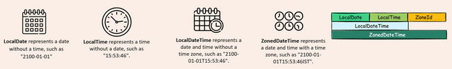

# Modern Date-Time API (`java.time`)

Java 8 introduced the `java.time` package (JSR-310). Its architectural principles are:

1. **Immutability & Thread Safety**: All core types are immutable value objects. Any modifying operation returns a new instance.
2. **Clear Separation of Concerns**: Distinct domain representations for date-only (`LocalDate`), time-only (`LocalTime`), date-time (`LocalDateTime`), and machine instants (`Instant`).
3. **Fluent API Prefix Conventions**:
   - `of`: Static factory constructors.
   - `now`: Obtains the current value from a clock.
   - `get`: Reads temporal fields.
   - `with`: Returns a copy with one field altered.
   - `plus` / `minus`: Temporal arithmetic.
   - `at`: Combines with another temporal type.
   - `to`: Converts to a related type.



---

## 1. Core Local Types

Local temporal types do **not** store timezone offsets. They represent wall-clock time as seen on a local calendar or clock:

```java
import java.time.LocalDate;
import java.time.LocalDateTime;
import java.time.LocalTime;
import java.time.ZonedDateTime;

public class Test {
    public static void main(String[] args) {
        LocalDate date = LocalDate.now();
        LocalTime time = LocalTime.now();
        LocalDateTime dateTime = LocalDateTime.now();
        ZonedDateTime zonedDateTime = ZonedDateTime.now();

        System.out.println("LocalDate:     " + date);          // 2024-12-18
        System.out.println("LocalTime:     " + time);          // 14:30:15.964948500
        System.out.println("LocalDateTime: " + dateTime);      // 2024-12-18T14:30:15.964948500
        System.out.println("ZonedDateTime: " + zonedDateTime); // 2024-12-18T14:30:15.964948500+05:30[Asia/Kolkata]
    }
}
```

---

## 2. Instantiation & Arithmetic (Immutability Trap)

```java
import java.time.LocalDate;
import java.time.LocalDateTime;
import java.time.LocalTime;
import java.time.Month;

public class Test {
    public static void main(String[] args) {
        // Factory methods: Months are 1-based or via Month enum
        LocalDate d1 = LocalDate.of(2024, Month.DECEMBER, 18);
        LocalDate d2 = LocalDate.of(2024, 12, 18);
        LocalTime t1 = LocalTime.of(14, 30, 45, 500_000_000); // hour, min, sec, nanos

        // Combining into LocalDateTime
        LocalDateTime dt = LocalDateTime.of(d1, t1);
        System.out.println("Combined: " + dt);

        // Arithmetic
        LocalDate plusDays = d1.plusDays(7);
        LocalDate minusMonths = d1.minusMonths(2);
        System.out.println("Plus 7 days:    " + plusDays);
        System.out.println("Minus 2 months: " + minusMonths);

        // IMMUTABILITY GOTCHA:
        LocalDate original = LocalDate.of(2024, 1, 1);
        original.plusDays(10); // Return value discarded!
        System.out.println("Original remained unchanged: " + original); // 2024-01-01
    }
}
```

---

## 3. Querying & Modifying Fields (`get` & `with`)

```java
import java.time.DayOfWeek;
import java.time.LocalDate;
import java.time.Month;

public class Test {
    public static void main(String[] args) {
        LocalDate date = LocalDate.of(2024, Month.DECEMBER, 18);

        // Field extraction
        int year          = date.getYear();          // 2024
        Month month       = date.getMonth();         // Month.DECEMBER
        int monthVal      = date.getMonthValue();    // 12 (1-indexed, no offset math!)
        int dayOfMonth    = date.getDayOfMonth();    // 18
        DayOfWeek dayWeek = date.getDayOfWeek();     // DayOfWeek.WEDNESDAY
        boolean isLeap    = date.isLeapYear();       // true

        System.out.printf("%s, %04d-%02d-%02d (Leap: %b)%n", dayWeek, year, monthVal, dayOfMonth, isLeap);

        // Modifying copies with `with` methods
        LocalDate nextYear = date.withYear(2025);
        LocalDate firstOfMonth = date.withDayOfMonth(1);
        System.out.println("Next year:       " + nextYear);
        System.out.println("First of month:  " + firstOfMonth);
    }
}
```

---

## 4. Combining and Converting (`at` and `to`)

```java
import java.time.LocalDate;
import java.time.LocalDateTime;
import java.time.LocalTime;

public class Test {
    public static void main(String[] args) {
        LocalDate date = LocalDate.of(2024, 12, 18);

        // at... creates a more detailed composite type
        LocalDateTime startOfDay = date.atStartOfDay(); // 2024-12-18T00:00
        LocalDateTime withTime   = date.atTime(18, 45); // 2024-12-18T18:45

        System.out.println("Start of day: " + startOfDay);
        System.out.println("At time:      " + withTime);

        // to... extracts lower-level components
        LocalDateTime dt = LocalDateTime.of(2024, 12, 18, 18, 45);
        LocalDate extractedDate = dt.toLocalDate();
        LocalTime extractedTime = dt.toLocalTime();

        System.out.println("Extracted Date: " + extractedDate);
        System.out.println("Extracted Time: " + extractedTime);
    }
}
```

---

## 5. TemporalAdjusters

`java.time.temporal.TemporalAdjusters` provides common date calculations (first/last day of month, next/previous day of week):

```java
import java.time.DayOfWeek;
import java.time.LocalDate;
import java.time.temporal.TemporalAdjusters;

public class Test {
    public static void main(String[] args) {
        LocalDate date = LocalDate.of(2024, 12, 18); // Wednesday

        LocalDate firstDayMonth = date.with(TemporalAdjusters.firstDayOfMonth());
        LocalDate lastDayMonth  = date.with(TemporalAdjusters.lastDayOfMonth());
        LocalDate nextFriday    = date.with(TemporalAdjusters.next(DayOfWeek.FRIDAY));
        LocalDate nextOrSameWed = date.with(TemporalAdjusters.nextOrSame(DayOfWeek.WEDNESDAY));

        System.out.println("First day of month: " + firstDayMonth); // 2024-12-01
        System.out.println("Last day of month:  " + lastDayMonth);  // 2024-12-31
        System.out.println("Next Friday:        " + nextFriday);    // 2024-12-20
        System.out.println("Next or same Wed:   " + nextOrSameWed); // 2024-12-18
    }
}
```

---

## 6. Testing Best Practice: Deterministic Testing with `Clock`

Hardcoding calls to `LocalDate.now()` or `LocalDateTime.now()` makes testing time-dependent logic non-deterministic. The modern API provides `java.time.Clock` as an injectable dependency:

```java
import java.time.Clock;
import java.time.Instant;
import java.time.LocalDate;
import java.time.ZoneId;

public class Test {
    public static void main(String[] args) {
        // Fixed clock simulating 2026-01-01T00:00:00Z for unit tests
        Instant fixedInstant = Instant.parse("2026-01-01T00:00:00Z");
        Clock fixedClock = Clock.fixed(fixedInstant, ZoneId.of("UTC"));

        SubscriptionService service = new SubscriptionService(fixedClock);
        LocalDate expiration = service.calculateExpiration();

        System.out.println("Deterministic Expiration: " + expiration); // Always 2026-01-31
    }
}

class SubscriptionService {
    private final Clock clock;

    public SubscriptionService(Clock clock) {
        this.clock = clock;
    }

    public LocalDate calculateExpiration() {
        return LocalDate.now(clock).plusDays(30);
    }
}
```
