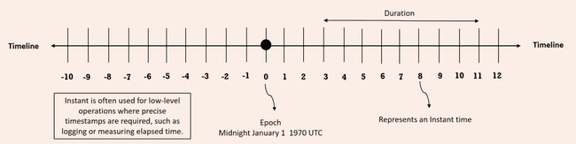
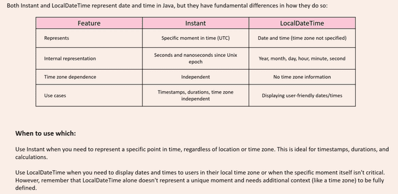

# Instance

We as humans, we use date and time values, but for machines, the time is calculated based upon the number of seconds passed from the Unix epoch time. What is epoch time? The epoch time inside computers is represented by the time, which is midnight of January 1st, 1970, UTC.

If you try to look at this representation, this zero represents the epoch time, which is midnight of January first, 1970, UTC. After this epoch time, we have various numbers like 1, 2, 3, 4. For each of these numbers, they represent the number of nanoseconds passed from the epoch time. If you try to travel on to the right-hand side, all the nanosecond numbers will be positive. Whereas if you try to travel on to the left-hand side, which is before epoch time, all the numbers are going to be represented with the help of negative numbers.

Each of these numbers inside the timeline, represents an instant time from the epoch time. That is each instance is nano second which is represented by Instant class in Java.  Duration class is used to identify the duration of time between two instances.

For example, between 3 and 11 the duration, it is going to be 8 nanoseconds.

Instant can be created like below with now method which will give current instant, but it will give normal Date format representation as toString method is overridden and provides this format

Instant i2 = Instant.now();System.out.println(i2);     // To String method of Instant will convert to readable format

Instant i1 = Instant.ofEpochSecond(1000);System.out.println(i1);     ***// Will give time 1000 second from Epoc time****long* seconds = i2.getEpochSecond();System.out.println(seconds);    ***//  No of seconds from Epoc time since the object was created****long* nanoSeconds = i2.getNano();    ***// Not no of nao seconds from epoc time***System.out.println(nanoSeconds);***// No of nanoseconds since the object i2 was created***

Duration cane created like below and it can be added to instant to created new instant

Instant i1 = Instant.ofEpochSecond(1000);System.out.println(i1);     ***// Will give time 1000 second from Epoc time***Instant i2 = Instant.now();System.out.println(i2);     ***// To String method of Instant will convert to readable format***Duration d1 = Duration.ofDays(5);Duration d2 = Duration.ofMinutes(10);Duration d3 = Duration.ofSeconds(30);Duration d4 = Duration.ofSeconds(-13);Duration d5 = d3.plus(d4);Instant i3 = i1.plus(d1);   ***//add duration to instant***Instant i4 = i2.minus(d2);  ***//Subtract duration from instant***System.out.println(i3);System.out.println(i4);*boolean* isAfter = i3.isAfter(i4); ***// false****boolean* isBefore = i3.isBefore(i4); ***// true***Duration duration = Duration.between(i1, i3);System.out.println(duration);***// PT120H 120 hours***
