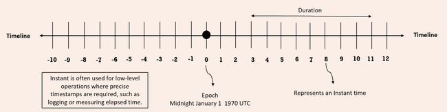
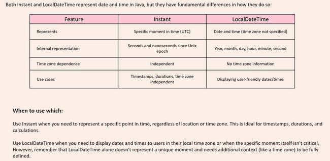

# Instant and Duration (`java.time.Instant` & `java.time.Duration`)

While classes like `LocalDate` represent human-centric dates, machines track time as a continuous timeline of nanoseconds measured from the **Unix Epoch** (January 1, 1970, 00:00:00 UTC).



---

## 1. `Instant` (Machine Timestamp)

An `Instant` represents a point on the continuous timeline in UTC with nanosecond precision. It is the modern replacement for `java.util.Date`.

```java
import java.time.Instant;
import java.time.temporal.ChronoField;

public class Test {
    public static void main(String[] args) {
        // Current UTC timestamp
        Instant now = Instant.now();
        System.out.println("Current Instant: " + now); // e.g., 2024-12-18T08:05:30.123456789Z

        // Instantiation from epoch seconds or millis
        Instant fromSec = Instant.ofEpochSecond(1000);
        Instant fromMilli = Instant.ofEpochMilli(System.currentTimeMillis());

        // Epoch components
        long epochSecond = now.getEpochSecond();
        int nanoAdjustment = now.getNano(); // Fraction of a second: 0 to 999,999,999
        System.out.println("Epoch seconds: " + epochSecond);
        System.out.println("Nanos fraction: " + nanoAdjustment);

        // ❌ Throws UnsupportedTemporalTypeException: Instant has no concept of human calendar fields
        // int day = now.get(ChronoField.DAY_OF_MONTH);
    }
}
```

> [!NOTE]
> `getNano()` does **not** return the total nanoseconds since epoch; it returns only the sub-second fractional nanosecond component (`0` to `999,999,999`).

---

## 2. `Duration` (Time-Based Amount)

`Duration` represents an amount of time measured in **seconds and nanoseconds**. It is designed for fine-grained differences between points on the time axis (`Instant`, `LocalTime`, `LocalDateTime`).



```java
import java.time.Duration;
import java.time.Instant;
import java.time.LocalTime;

public class Test {
    public static void main(String[] args) {
        // Factory creation
        Duration twoHours = Duration.ofHours(2);
        Duration ninetySec = Duration.ofSeconds(90);
        System.out.println("Two hours ISO: " + twoHours);   // PT2H (Period of Time 2 Hours)
        System.out.println("90 seconds:    " + ninetySec);   // PT1M30S

        // Measuring difference between Instants
        Instant start = Instant.now();
        Instant end = start.plus(Duration.ofMinutes(150));
        Duration diff = Duration.between(start, end);

        System.out.println("Total minutes: " + diff.toMinutes()); // 150
        System.out.println("Total hours:   " + diff.toHours());   // 2
        System.out.println("Part minutes:  " + diff.toMinutesPart()); // 30 (Java 9+)

        // Difference between LocalTimes
        LocalTime t1 = LocalTime.of(9, 0);
        LocalTime t2 = LocalTime.of(17, 30);
        System.out.println("Workday:       " + Duration.between(t1, t2)); // PT8H30M
    }
}
```

---

## 3. Arithmetic and Incompatible Types

`Duration` can be added to and subtracted from temporal types that possess a time-of-day or instant representation:

```java
import java.time.Duration;
import java.time.Instant;
import java.time.LocalDate;

public class Test {
    public static void main(String[] args) {
        Instant now = Instant.now();

        Instant future = now.plus(Duration.ofDays(3));
        Instant past = now.minus(Duration.ofHours(6));

        System.out.println("future.isAfter(past): " + future.isAfter(past));

        LocalDate date = LocalDate.of(2024, 12, 18);
        // ❌ Throws UnsupportedTemporalTypeException: LocalDate has no seconds or nanoseconds!
        // LocalDate invalid = date.plus(Duration.ofHours(5));
    }
}
```

---

## 4. Scaling and Truncating `Duration`

```java
import java.time.Duration;
import java.time.temporal.ChronoUnit;

public class Test {
    public static void main(String[] args) {
        Duration base = Duration.ofMinutes(40);

        // Scaling methods
        Duration doubled = base.multipliedBy(2); // PT1H20M
        Duration halved  = base.dividedBy(2);     // PT20M
        Duration negated = base.negated();        // PT-40M

        System.out.println("Doubled: " + doubled);
        System.out.println("Halved:  " + halved);
        System.out.println("Negated: " + negated);

        // Truncation
        Duration detailed = Duration.ofHours(3).plusMinutes(45).plusSeconds(30);
        Duration hourTruncated = detailed.truncatedTo(ChronoUnit.HOURS);

        System.out.println("Detailed:  " + detailed);      // PT3H45M30S
        System.out.println("Truncated: " + hourTruncated);  // PT3H
    }
}
```
