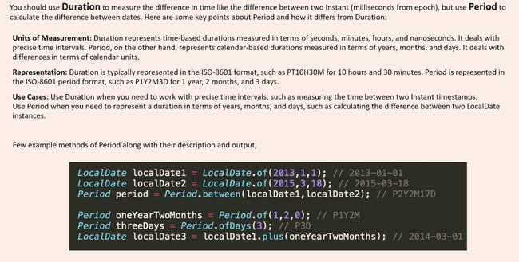

# Period (`java.time.Period`) & `ChronoUnit`

While `Duration` measures time-based amounts (seconds and nanoseconds), `Period` measures **date-based amounts** (years, months, and days) on the human calendar.



---

## 1. Contrast: `Period` vs `Duration`

| Dimension | `Period` | `Duration` |
| :--- | :--- | :--- |
| **Components** | Years, Months, Days | Seconds, Nanoseconds |
| **Applicable Types** | `LocalDate` | `Instant`, `LocalTime`, `LocalDateTime` |
| **ISO-8601 Format** | `P...` (e.g., `P2Y3M15D`) | `PT...` (e.g., `PT2H30M15S`) |
| **Daylight Saving Time** | Preserves calendar date | Preserves exact elapsed seconds |

---

## 2. Measuring with `Period` and the `getDays()` Trap

```java
import java.time.LocalDate;
import java.time.Period;
import java.time.temporal.ChronoUnit;

public class Test {
    public static void main(String[] args) {
        LocalDate start = LocalDate.of(2022, 1, 1);
        LocalDate end   = LocalDate.of(2024, 3, 18);

        Period period = Period.between(start, end);
        System.out.println("Period ISO: " + period); // P2Y2M17D

        // Component breakdown
        int years  = period.getYears();  // 2
        int months = period.getMonths(); // 2
        int days   = period.getDays();   // 17
        System.out.printf("Broken down: %d years, %d months, %d days%n", years, months, days);

        // ⚠️ CRITICAL GOTCHA:
        // period.getDays() only returns the remainder day field (17), NOT total elapsed days!
        long totalDays = ChronoUnit.DAYS.between(start, end);
        System.out.println("period.getDays() (field only): " + period.getDays()); // 17
        System.out.println("Total elapsed days:           " + totalDays);          // 807
    }
}
```

---

## 3. Date Arithmetic & Scaling

```java
import java.time.Instant;
import java.time.LocalDate;
import java.time.Period;

public class Test {
    public static void main(String[] args) {
        LocalDate baseDate = LocalDate.of(2024, 1, 1);
        Period quarterly = Period.ofMonths(3).plusDays(5); // P3M5D

        LocalDate future = baseDate.plus(quarterly);
        LocalDate past   = baseDate.minus(quarterly);

        System.out.println("Future Date: " + future); // 2024-04-06
        System.out.println("Past Date:   " + past);   // 2023-09-26

        // Scaling methods
        Period doubled = quarterly.multipliedBy(2); // P6M10D
        Period negated = quarterly.negated();      // P-3M-5D
        System.out.println("Doubled:     " + doubled);
        System.out.println("Negated:     " + negated);

        // ❌ Throws UnsupportedTemporalTypeException: Instant has no year/month/day calendar fields
        // Instant.now().plus(quarterly);
    }
}
```

---

## 4. Total Elapsed Units with `ChronoUnit`

When a single total delta (total days, total weeks, total months) is required rather than a broken-down tuple, use `ChronoUnit.between()`:

```java
import java.time.LocalDate;
import java.time.temporal.ChronoUnit;

public class Test {
    public static void main(String[] args) {
        LocalDate hireDate = LocalDate.of(2021, 6, 1);
        LocalDate reviewDate = LocalDate.of(2024, 11, 1);

        long totalDays   = ChronoUnit.DAYS.between(hireDate, reviewDate);
        long totalWeeks  = ChronoUnit.WEEKS.between(hireDate, reviewDate);
        long totalMonths = ChronoUnit.MONTHS.between(hireDate, reviewDate);
        long totalYears  = ChronoUnit.YEARS.between(hireDate, reviewDate);

        System.out.println("Total Days:   " + totalDays);   // 1249
        System.out.println("Total Weeks:  " + totalWeeks);  // 178
        System.out.println("Total Months: " + totalMonths); // 41
        System.out.println("Total Years:  " + totalYears);  // 3
    }
}
```
