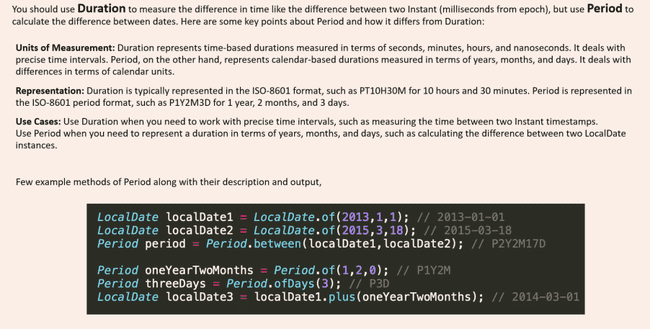

# Period

With the help of Duration, we can identify the duration between two instances. Very similarly, if you are looking to identify the difference between two different dates, we can use Period class. Instant method between method was showing difference in hours while period will show in days, hours minutes

LocalDate localDate1 = LocalDate.of(2013,1,1); ***// 2013-01-01***LocalDate localDate2 = LocalDate.of(2015,3,18); ***// 2015-03-18***Period period = Period.between(localDate1,localDate2); ***// P2Y2M17D 2 years 2 months 17 days***System.out.println(period);Period oneYearTwoMonths = Period.of(1,2,0); ***// P1Y2M***System.out.println(oneYearTwoMonths);Period threeDays = Period.ofDays(3); ***// P3D***LocalDate localDate3 = localDate1.plus(oneYearTwoMonths); ***// 2014-03-01***System.out.println(localDate3);// Can add substract to local date

We can use multiplication, division on Duration and Instant class not applicable for DateTime objects

Duration originalDuration = Duration.ofMinutes(30); ***// PT30M***Duration multipliedDuration = originalDuration.multipliedBy(3); ***// PT1H30M***Duration dividedDuration = originalDuration.dividedBy(2); ***// PT15M***Duration negatedDuration = originalDuration.negated(); ***// PT-30M***Period originalPeriod = Period.ofDays(3); ***// P3D***Period multipliedPeriod = originalPeriod.multipliedBy(3); ***// P9D***Period negatedPeriod = originalPeriod.negated(); ***// P-3D***

Duration always gives duration in Hours Say if we want to truncate the Minutes and seconds we can use truncated

Duration duration = Duration.ofDays(28).        plusHours(6).        plusMinutes(56).        plusSeconds(19); ***// PT678H56M19S***Duration daysTruncated = duration.truncatedTo(ChronoUnit.DAYS); ***// PT672H hours are truncated*** Duration hoursTruncated = duration.truncatedTo(ChronoUnit.HOURS); ***// PT678H minutes truncated*** Duration minutesTruncated = duration.truncatedTo(ChronoUnit.MINUTES); ***// PT678H56M seconds truncated***
