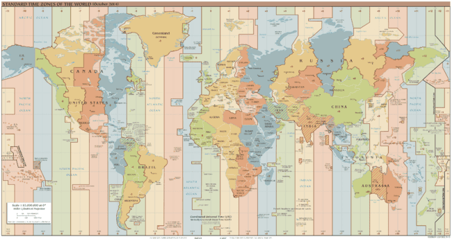

# Zone, Offset & Daylight Saving Time

Handling time in distributed systems requires precise modeling of UTC offsets, geographic timezones, and Daylight Saving Time (DST) transition boundaries.



---

## 1. UTC Offset vs Time Zone

- **UTC Offset (`ZoneOffset`)**: A fixed, invariant difference from UTC/Greenwich (e.g., `+05:30`, `-08:00`). It has **no awareness of DST or political boundaries**.
- **Time Zone (`ZoneId`)**: A geographic region identifier (e.g., `America/New_York`, `Europe/London`) that contains the historical and future rules for offset shifts and DST.

$$\text{ZoneId} = \text{Geographic Identifier} + \text{ZoneRules (DST transitions)}$$

```java
import java.time.ZoneId;
import java.time.ZoneOffset;
import java.util.Set;

public class Test {
    public static void main(String[] args) {
        // Fixed offset (does not observe DST)
        ZoneOffset fixedOffset = ZoneOffset.ofHoursMinutes(5, 30); // +05:30
        System.out.println("Fixed Offset: " + fixedOffset);

        // Geographic ZoneId (evaluates DST rules dynamically)
        ZoneId nyZone = ZoneId.of("America/New_York");
        System.out.println("Zone Rules:   " + nyZone.getRules());

        // Supported geographic zone count
        Set<String> zoneIds = ZoneId.getAvailableZoneIds();
        System.out.println("Total Zone IDs: " + zoneIds.size());
    }
}
```

---

## 2. Choosing the Right Type: `Instant` vs `OffsetDateTime` vs `ZonedDateTime`

| Type | Components | Production Use Case |
| :--- | :--- | :--- |
| **`Instant`** | Epoch nanoseconds (UTC) | Database timestamps, distributed event sequencing, system logs. |
| **`OffsetDateTime`** | Date + Time + `ZoneOffset` | REST APIs (ISO-8601 payloads), serialization across microservices. |
| **`ZonedDateTime`** | Date + Time + Offset + `ZoneId` | Calendar scheduling, recurring alarms across DST shifts, UI localized display. |

```java
import java.time.Instant;
import java.time.OffsetDateTime;
import java.time.ZoneId;
import java.time.ZoneOffset;
import java.time.ZonedDateTime;

public class Test {
    public static void main(String[] args) {
        Instant nowUtc = Instant.now();
        ZoneId zone = ZoneId.of("America/New_York");

        // Instant -> ZonedDateTime (preserves DST intelligence)
        ZonedDateTime zdt = nowUtc.atZone(zone);

        // ZonedDateTime -> OffsetDateTime (drops zone rules, retains current offset)
        OffsetDateTime odt = zdt.toOffsetDateTime();

        // OffsetDateTime -> Instant
        Instant backToInstant = odt.toInstant();

        System.out.println("Instant:        " + nowUtc);
        System.out.println("ZonedDateTime:  " + zdt);
        System.out.println("OffsetDateTime: " + odt);
        System.out.println("Back to Instant:" + backToInstant);
    }
}
```

---

## 3. Timezone Conversions: Instant vs Local Wall-Clock

- **`withZoneSameInstant()`**: Keeps the exact machine moment identical; adjusts the local time to reflect the new zone.
- **`withZoneSameLocal()`**: Keeps the local wall-clock numbers identical; changes the zone, which alters the underlying instant.

```java
import java.time.ZoneId;
import java.time.ZonedDateTime;

public class Test {
    public static void main(String[] args) {
        ZoneId london = ZoneId.of("Europe/London");
        ZoneId tokyo = ZoneId.of("Asia/Tokyo");

        // 14:00 in London
        ZonedDateTime londonTime = ZonedDateTime.of(2024, 6, 1, 14, 0, 0, 0, london);

        // 1. Same Instant in Tokyo (Tokyo is 8 hours ahead)
        ZonedDateTime tokyoSameInstant = londonTime.withZoneSameInstant(tokyo);

        // 2. Same Local wall-clock time in Tokyo (clock says 14:00, but in Tokyo)
        ZonedDateTime tokyoSameLocal = londonTime.withZoneSameLocal(tokyo);

        System.out.println("London original:      " + londonTime);
        System.out.println("Tokyo (same instant): " + tokyoSameInstant); // 22:00 in Tokyo
        System.out.println("Tokyo (same local):   " + tokyoSameLocal);   // 14:00 in Tokyo (different instant!)
    }
}
```

---

## 4. Daylight Saving Time: Gaps and Overlaps

During DST transitions, the local clock either jumps forward (a **gap** where time does not exist) or falls back (an **overlap** where time is ambiguous):

- **Spring Forward (Gap)**: At 02:00, clocks advance to 03:00. Local times between 02:00:00 and 02:59:59 do not exist; `ZonedDateTime` automatically shifts them forward by the gap length.
- **Fall Back (Overlap)**: At 02:00, clocks fall back to 01:00. Times between 01:00:00 and 01:59:59 occur twice.

```java
import java.time.LocalDateTime;
import java.time.ZoneId;
import java.time.ZonedDateTime;

public class Test {
    public static void main(String[] args) {
        ZoneId nyZone = ZoneId.of("America/New_York");

        // 1. DST GAP (Spring forward: March 10, 2024)
        // 02:30 does NOT exist locally; clocks jumped from 02:00 directly to 03:00
        LocalDateTime gapTime = LocalDateTime.of(2024, 3, 10, 2, 30);
        ZonedDateTime resolvedGap = gapTime.atZone(nyZone);
        System.out.println("Gap 02:30 resolved to: " + resolvedGap); // 03:30 EDT (-04:00)

        // 2. DST OVERLAP (Fall back: November 3, 2024)
        // 01:30 occurs TWICE: once in EDT (-04:00), once in EST (-05:00)
        LocalDateTime overlapTime = LocalDateTime.of(2024, 11, 3, 1, 30);
        ZonedDateTime defaultOverlap = overlapTime.atZone(nyZone);
        ZonedDateTime earlierOverlap = defaultOverlap.withEarlierOffsetAtOverlap();
        ZonedDateTime laterOverlap   = defaultOverlap.withLaterOffsetAtOverlap();

        System.out.println("Earlier (EDT): " + earlierOverlap); // 01:30-04:00
        System.out.println("Later   (EST): " + laterOverlap);   // 01:30-05:00
    }
}
```

---

## 5. Non-ISO Chronologies (`java.time.chrono`)

For applications interacting with non-Gregorian cultural calendar systems:

```java
import java.time.LocalDate;
import java.time.chrono.JapaneseDate;
import java.time.chrono.MinguoDate;

public class Test {
    public static void main(String[] args) {
        LocalDate isoDate = LocalDate.of(2024, 12, 18);

        // Japanese Imperial calendar
        JapaneseDate japaneseDate = JapaneseDate.from(isoDate);
        System.out.println("Japanese Era: " + japaneseDate); // Japanese Reiwa 6-12-18

        // Taiwanese Republic calendar
        MinguoDate minguoDate = MinguoDate.from(isoDate);
        System.out.println("Minguo Date:  " + minguoDate);  // Minguo ROC 113-12-18

        // Round-trip back to ISO LocalDate
        LocalDate backToIso = LocalDate.from(japaneseDate);
        System.out.println("Back to ISO:  " + backToIso);   // 2024-12-18
    }
}
```
