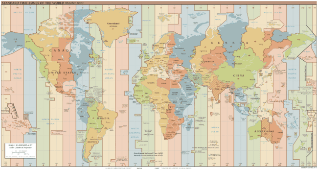

# Zone, Offset & Daylight Saving Time

To work with global applications, Java provides specialized classes to handle UTC offsets, geographic timezones, and Daylight Saving Time (DST).



---

## 1. UTC Offset vs Time Zone

- **UTC Offset (`ZoneOffset`)**: A fixed, absolute time difference from Greenwich / UTC 0 (e.g., `+05:30`, `-08:00`). It has **no awareness of DST or political borders**.
- **Time Zone (`ZoneId`)**: A geographic region (e.g., `America/New_York`, `Europe/London`) that shares the same standard time and DST transition rules.
  
$$\text{ZoneId} = \text{ZoneOffset} + \text{ZoneRules (DST changes)}$$

```java
import java.time.ZoneId;
import java.time.ZoneOffset;
import java.util.Set;

// Fixed offset
ZoneOffset offset = ZoneOffset.ofHoursMinutes(5, 30); // +05:30

// Geographic ZoneId with DST awareness
ZoneId zone = ZoneId.of("America/New_York");

// List all supported geographic zones
Set<String> zoneIds = ZoneId.getAvailableZoneIds();
```

---

## 2. `ZonedDateTime` vs `OffsetDateTime`

| Class | Components | Typical Use Case |
| :--- | :--- | :--- |
| **`ZonedDateTime`** | Date + Time + Offset + `ZoneId` | User-facing calendar events, flight schedules with DST |
| **`OffsetDateTime`** | Date + Time + `ZoneOffset` | REST APIs, database persistence, logging timestamps |

```java
import java.time.OffsetDateTime;
import java.time.ZoneId;
import java.time.ZoneOffset;
import java.time.ZonedDateTime;

ZoneId nyZone = ZoneId.of("America/New_York");
ZoneOffset nyOffset = ZoneOffset.ofHours(-5);

// ZonedDateTime (retains zone rules)
ZonedDateTime zdt = ZonedDateTime.now(nyZone);
System.out.println(zdt); 
// 2024-12-18T10:30:00-05:00[America/New_York]

// OffsetDateTime (fixed offset, no zone rules)
OffsetDateTime odt = OffsetDateTime.now(nyOffset);
System.out.println(odt); 
// 2024-12-18T10:30:00-05:00
```

---

## 3. Timezone Conversions (`withZoneSameInstant`)

To find the corresponding local time of an instant in another timezone:

```java
import java.time.ZoneId;
import java.time.ZonedDateTime;

ZoneId indiaZone = ZoneId.of("Asia/Kolkata");
ZoneId chicagoZone = ZoneId.of("America/Chicago");

// Instant in India
ZonedDateTime indiaTime = ZonedDateTime.now(indiaZone);

// Convert to same instant in Chicago
ZonedDateTime chicagoTime = indiaTime.withZoneSameInstant(chicagoZone);

System.out.println("India   : " + indiaTime);
System.out.println("Chicago : " + chicagoTime);
```

---

## 4. Daylight Saving Time (DST) in Action

In regions observing DST (e.g., USA), clocks jump forward 1 hour in spring (losing an hour) and fall back 1 hour in autumn. `ZonedDateTime` automatically adjusts offsets across these transitions:

```java
import java.time.ZoneId;
import java.time.ZonedDateTime;

ZoneId laZone = ZoneId.of("America/Los_Angeles");
ZoneId nyZone = ZoneId.of("America/New_York");

// 1. Flight departing March 8, 2024 (Before DST shift):
// LA is PST (-08:00), NY is EST (-05:00). 3 hours difference + 4 hours flight = arrival at 04:00 AM
ZonedDateTime dep1 = ZonedDateTime.of(2024, 3, 8, 21, 0, 0, 0, laZone);
ZonedDateTime arr1 = dep1.plusHours(4).withZoneSameInstant(nyZone);

System.out.println("Dep 1 (PST): " + dep1); // 2024-03-08T21:00-08:00[America/Los_Angeles]
System.out.println("Arr 1 (EST): " + arr1); // 2024-03-09T04:00-05:00[America/New_York]

// 2. Flight departing March 9, 2024 (Crosses DST transition on March 10 at 02:00 AM):
// NY shifts from EST (-05:00) to EDT (-04:00), advancing the clock by 1 hour.
ZonedDateTime dep2 = ZonedDateTime.of(2024, 3, 9, 21, 0, 0, 0, laZone);
ZonedDateTime arr2 = dep2.plusHours(4).withZoneSameInstant(nyZone);

System.out.println("Dep 2 (PST): " + dep2); // 2024-03-09T21:00-08:00[America/Los_Angeles]
System.out.println("Arr 2 (EDT): " + arr2); // 2024-03-10T05:00-04:00[America/New_York] (Clocks shifted!)
```

---

## 5. Non-ISO Chronologies (`java.time.chrono`)

Most systems use the ISO-8601 Gregorian calendar, but `java.time.chrono` supports other cultural calendar systems:
- `JapaneseDate` (era-based)
- `ThaiBuddhistDate`
- `HijrahDate` (Islamic lunar calendar)
- `MinguoDate` (Taiwanese calendar)

```java
import java.time.LocalDate;
import java.time.chrono.JapaneseDate;

LocalDate isoDate = LocalDate.of(2024, 12, 18);

// Convert ISO LocalDate to JapaneseDate
JapaneseDate japaneseDate = JapaneseDate.from(isoDate);
System.out.println(japaneseDate); // Japanese Reiwa 6-12-18

// Convert back to ISO LocalDate
LocalDate backToIso = LocalDate.from(japaneseDate);
System.out.println(backToIso);    // 2024-12-18
```
