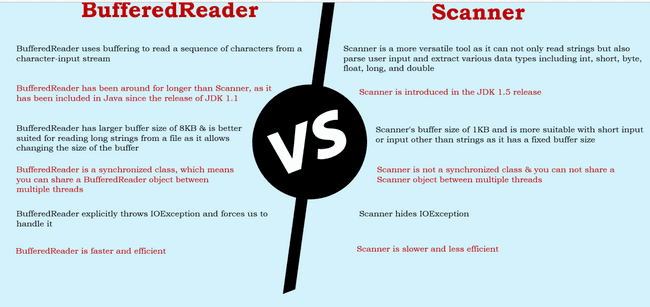

# Input Output

We have System.out.println to print to console. Where System class has a variable out which is of type PrintStream which opens a connection to console sends the data and closes it.

Like PrintStream is for output to console there is an InputStream as well which is exposed using System.in

```java
public static void main(String[] args) throws IOException {    System.out.println("Please enter a value");    int i = System.in.read();    System.out.println("User entered --> "+ i);}

```

This will give the ASCII value so 5 will become 53, 7 will become 55 etc. Also, it accepts only single character so if we enter 25 it will take 2

BufferedReader class extends to another Reader class which is an abstract class. BufferReader has additional logic, which is going to read the input data in a byte stream format. This approach can read a single character, a word, a sentence, a file, regardless of whatever amount you are trying to provide as an input. It has a buffer size and it can read that many characters at once making it efficient rather than reading one character at a time. The default is 8 kb as defined in the constructors.

```java
public BufferedReader(Reader in) {    this(in, defaultCharBufferSize);}

```

*private static int* defaultCharBufferSize = 8192;

We can also override the size with another constructor

```java
public BufferedReader(Reader in, int sz) {    super(in);    if (sz <= 0)        throw new IllegalArgumentException("Buffer size <= 0");    this.in = in;    cb = new char[sz];    nextChar = nChars = 0;}

```

How to read from console we have to create instance of Reader and pass to BufferedReader constructor which accepts a type of Reader. Since Reader is abstract class we can’t create an instance of it so instead we have to create an instance of its implementations . For console input we have to use InputStreamReader.

```java
public static void main(String[] args) throws IOException {    System.out.println("Please enter a value");    InputStreamReader inputStreamReader = new InputStreamReader(System.in);    BufferedReader bufferedReader = new BufferedReader(inputStreamReader);    String in = bufferedReader.readLine();    System.out.println("User input -->"+ in);    bufferedReader.close();}

```

Similarly we can read from file by passing File reader.

FileReader fileReader = *new* FileReader("/Users/eazybytes/Desktop/story.txt");BufferedReader reader = *new* BufferedReader(fileReader);String line;*while* ((line = reader.readLine()) != *null*){    System.out.println(line);}reader.close();

There is another convenient way to read input added in Java 1.5

```java
public static void main(String[] args) {    Scanner sc = new Scanner(System.in);    System.out.println("Enter your name:");    String name = sc.nextLine(); // reads the entire input    System.out.println("Enter your age:");    int age = sc.nextInt();     // Converts to Int    System.out.println("Hello " + name + " , you are " + age + " years old.");    System.out.println("How are you?");    String s = sc.next();       // reads only one word    System.out.println(s);    sc.close();}

```



Don’t use Print line in for prod

- Because whenever you want to print a big message onto your console, first it has to get an object of PrintStream. When this object of PrintStream is getting created, a connection to your console will be opened behind the scenes. And with that connection, only the message will be printed onto the console. And at last, the connection with the console, which is established by the PrintStream object, has to be closed behind the scenes, since these kinds of operations are happening behind the scenes, so there is a good chance that a performance degradation can happen.

- For large projects with large no of classes it will not give information which class and method is printing the logs

- Can’t disable logging.

- Can’t maintain logging levels

Logging

*private static final* Logger logger = Logger.getLogger(Test.*class*.getName());*public static void* main(String[] args) {    logger.setLevel(Level.SEVERE);    logger.info("This is info level logging");      ***// will keep the message severity as info*** logger.log(Level.WARNING, "This is warning level logging"); ***// Can pass the logging level*** logger.severe("This is severe level logging");      ***// will keep the logging level as severe*** System.out.println("Hello using System.out.println");}

Different operating systems use different file systems to manage their data. But the JVM will automatically connect to the local file system, allowing you to perform the same operations across multiple platforms. Different operating systems vary in their format of pathnames. For example, Unix‐based systems use the forward slash, /, for paths, whereas Windows‐based systems use the backslash \ character. Java offers two options to retrieve the local separator character: a system property and a static variable defined in the File class

```java
System.out.println(System.getProperty("file.separator"));
System.out.println(java.io.File.separator);

```

java.io.File class is used to read information about

●existing files and directories,

●list the contents of a directory,

●create/delete files and directories.

The File class cannot read or write data within a file, although it can be passed as a reference to many stream classes to read or write data

File operator usually takes a String which can be either an absolute path or relative path to the current directory. There are 3 ways to create files.

File file1 = new File("text.txt");Pass the relative or absolute path

File file2 = new File("test.txt", "new.txt");Pass the path of a parent file to create child file

File file3 = new File(file1, "new.txt");Pass the reference of parent file

Note: Creating file object doesn't create a file in system

```java
System.out.println(file1.exists());//Without file will be false
```
