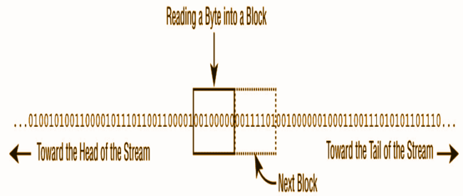

# I/O Stream

The contents of a file may be accessed or written via a stream, which is a list of data elements presented sequentially. Streams are like long, nearly never‐ending “streams of water” with data presented one “wave” at a time. The stream is so large that once we start reading it, we have no idea where the beginning or the end is. We just have a pointer to our current position in the stream and read data one block at a time.

Each type of stream segments data into a “wave” or “block” in a particular way. For example, some stream classes read or write data as

- Individual bytes.

- Individual characters or strings of characters

- Larger groups of bytes or characters at a time.

Irrespective of how the data is read or written nearly all are built on top of reading or writing an individual byte or an array of bytes at a time.

The reason higher-level streams exist is for convenience, as well as performance. For example, writing a file one byte at a time is time-consuming and slow in practice because the round-trip between the Java application and the file system is relatively expensive. By utilizing a BufferedOutputStream, the Java application can write a large chunk of bytes at a time, reducing the round-trips and drastically improving performance.

Files can be big like 1 TB. What stream does is helps reading chunks of data thus allowing systems with smaller specifications to be able to read data.
