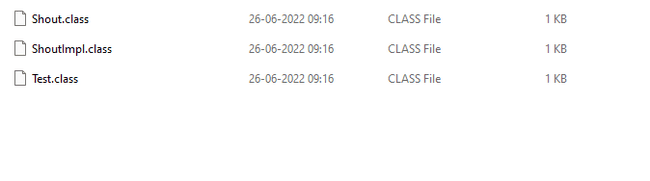

# Lambda

A lambda expression/function is a short block of code which takes in parameters and can return a value or execute some statements. Lambda expressions are like methods, but they do not need a name, and they can be implemented right in the body of a method.

Syntax of lambda expression is

(parameters) 🡪 {statements}

if the lambda function has one statement, we can write like this

(parameter) -> statement;

Rules of Lambda

- We need to pass parameters in () followed by -> and our statements we can put inside {}. If we have single statement {} is optional

```java
public void test() {
    System.out.println("Hello");
    System.out.println("World");
}
```

```java
() -> {
    System.out.println("Hello");
    System.out.println("World");
};
```

```java
public void test() {
    System.out.println("Hello");
}
```

```java
() -> System.out.println("Hello");
```

- For passing multiple params to Lambda () is to be used, it is not needed for single params

s -> System.out.println(s).

(s, r) -> System.out.println(s);

```java
public void add(int i, int j) {
    System.out.println(i+j);
}
```

```java
(i, j) -> System.out.println(i +j);
```

```java
public void doubleValue(int i) {
    System.out.println(i*2);
}
```

```java
i -> System.out.println(i *2);
```

- return keyword: return keyword is implied and is optional `s -> {return true;};` is same as  `s -> true;` However for multiple line statements or if we use {}return keyword is must

| public int add(int i, int j) {<br>   return  (i+j);<br>} | (i, j) -> {<br>    return (i + j);<br>};<br>Or<br>(i, j) -> i + j; |
| --- | --- |

- It is a good practice to keep one or two lines of code in Lambda expression (not a rule but more of a best practice).

For a Lambda we need a functional interface. **Functional Interface** in Java is an interface that contains only one abstract method. It can have any number of default or static methods but must contain exactly one abstract method. We can annotate with @*FunctionalInterface* which will force the interface to have single abstract method. This will prevent anyone else from making it not a functional interface by adding another abstract method.

@FunctionalInterfaceinterface DoSomething {    void doSomething();}

The way we use lambda expression is that we can override the functional interface in the Lambda code itself without the need of creating an implementation of Functional interface or writing an inner class implementation. For e.g. here we have a FI with abstract method test. We created an inline implementation and called the test method.

```java
public class Test {    public static void main(String[] args) {        DoSomething doSomething = () -> System.out.println("doing");        doSomething.test();    }}@FunctionalInterfaceinterface DoSomething {    void test();}

```

A Lambda expression always needs a functional interface method to execute i.e. interface with one abstract method. It doesn't work with Abstract class.

With lambda expression we can pass the implementation as a reference to method. In imperative programming we can pass only data in form method parameters like objects and parameters, but functional programming allows us to pass implementation as well

```java
public class Test {    public static void main(String[] args) {        DoSomething doSomething = () -> System.out.println("doing");        DoSomething doSomething1 = () -> System.out.println("doing");        method(doSomething);        // passing implementation as parameter        method(doSomething1);       // passing implementation as parameter    }    public static void method(DoSomething doSomething) {        doSomething.test();    }}@FunctionalInterfaceinterface DoSomething {    void test();}

```

Some other examples, here we can see that with same FI we can pass different implementation as per our requirements

```java
public class Test {    public static void main(String[] args) {        Calculate calculate = (i, j) -> i+ j;        System.out.println(operation(calculate, 2,3)); // Passing the implementation to method        Calculate calculate1 = ((i, j) -> i-j);        System.out.println(calculate1.calculate(4,2)); // Directly calling FI        Calculate calculate2 = ((i, j) -> i*j);        System.out.println(calculate2.calculate(4,2));        Calculate calculate3 = ((i, j) -> i/j);        System.out.println(calculate3.calculate(4,2));    }    public static int operation(Calculate calculate, int i, int j) {        return calculate.calculate(i, j);    }}@FunctionalInterfaceinterface Calculate {    int calculate(int i, int j);}

```

Usual way of working with interface is that

- We must create a class implementing it, provide the implementation and initialize it and then calling the method. But with this approach lines of code increases, and application becomes complicated, and they create extra class files which can bloat the footprint of application

```java
public class Test {
    public static void main(String[] args) {
        ShoutImpl sh = new ShoutImpl();
        sh.shout();
    }
}
@FunctionalInterface
interface Shout {
    void shout();
}
class ShoutImpl implements Shout {
    @Override
    public void shout() {
        System.out.println("Interface");
    }
}
```



- Or create an inner class implementation. Here we create an anonymous inner class implementation, but this also makes the application complicated and bloated. Also, since this doesn’t mandate the use of Functional interface so if the interface have more than one abstract method we have to implement all the abstract methods weather we need it or not.

```java
public class Test {
    public static void main(String[] args) {
        Shout shoutInnerClass = new Shout() {
            public void shout() {
                System.out.println("Inner Class");
            }
        };
        shoutInnerClass.shout();
    }
}
@FunctionalInterface
interface Shout {
    void shout();
}
```


But with Lambda we can provide the implementation in line. And we don’t see any extra class file which can bloat our application size.

```java
public class Test {
    public static void main(String[] args) {
        Shout sh = () -> System.out.println("Lambda");
        sh.shout();
    }
}
@FunctionalInterface
interface Shout {
    void shout();
}
```


