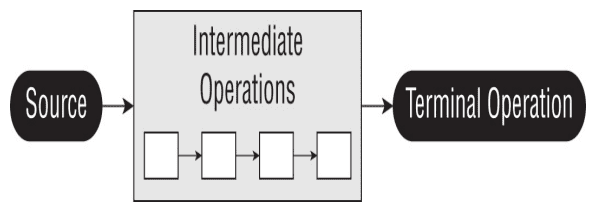

# Stream

A Stream in Java represents a sequence of elements and supports different operations to perform computations on these elements. Streams allow for functional-style operations to be performed on collections of objects, such as filtering, mapping, reducing, and more. Stream provides a feature called stream pipeline which consists of the operations that run on a stream to produce a result. There are three parts to a stream pipeline

- **Source**: Where the stream is generated

- **Intermediate operations**: Can transforms in stream. There can be one or more intermediate operations. Since streams use lazy evaluation, the intermediate operations do not run until the terminal operation runs.

- **Terminal operation**: Actually, produces a result from stream. Since streams can be used only once, the stream is no longer valid after a terminal operation completes.

Creating Stream or source

Empty Stream

Stream<String> empty = Stream.empty();

Stream from elements

Stream<Integer> singleElement = Stream.of(1);

Stream<Integer> fromArray = Stream.of(1, 2, 3);

Stream from collections

var list = List.of("a", "b", "c");

Stream<String> fromList = list.stream();

Stream class provides generate method which takes a Supplier as input to create infinite stream

Random rd = new Random();

Stream<Integer> intStream = Stream.generate(rd::nextInt);

intStream.limit(5).forEach(System.out::println);

Infinite stream which generates Random Double with Supplier

Stream<Double> doubleStream = Stream.generate(Math::random);

doubleStream.limit(5).forEach(System.out::println);

Infinite Stream of String "YO"

Stream<String> stringStream = Stream.generate(() -> "YO");

stringStream.limit(5).forEach(System.out::println);

Stream also provides an iterate method to create streams. It takes in a seed which is the initial value and an unary operator to generate next values. This generates an infinite stream.

var intStream = Stream.iterate(1, s -> s + 1);

intStream.limit(5).forEach(System.out::println);

There is another overloaded version of iterate which takes a seed, an unary operator and a predicate to determine condition, This was introduced in Java 9 and the predicate can be used to make the stream finite. When the predicate returns false the stream stops

var intStream = Stream.iterate(0, s -> s < 20, s -> s + 1);

intStream.forEach(System.out::println);

Features

- **Lazy Evaluation**: Streams perform operations only when necessary. Intermediate operations are typically lazy, meaning they do not compute a result until the result is needed by a terminal operation.

- **Parallel Processing**: Streams can leverage parallel processing, making it easier to write parallelizable code to take advantage of multi-core processors.

- **Functional Composition**: Streams provide methods for composing operations in a functional style, making it easy to chain multiple operations together.

- **No Storage**: Streams in Java are not data storage containers; instead, they provide a way to process elements from a source (such as a collection, array, or I/O channel) in a functional and declarative style. Streams operate on data elements in a sequence and allow for various operations to be performed on those elements, such as filtering, mapping, sorting, and reducing.
