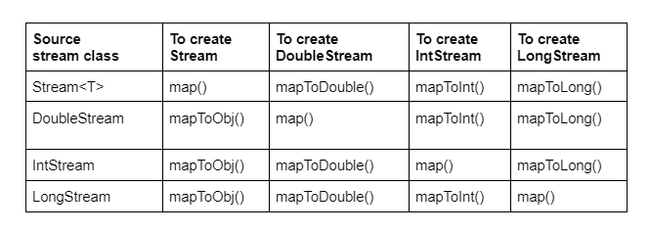
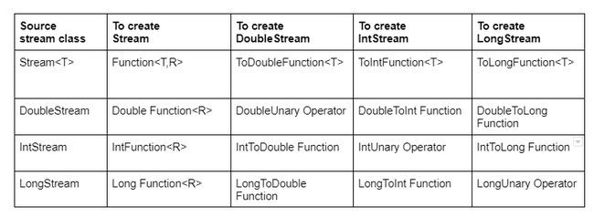

# Mapping Stream

We can map streams from one type to another. They have to be compatible types for this to work. Java requires a mapping function to be provided as a parameter

This function takes an Object, which is a String in this case. The function returns an int. The function mappings are intuitive here. They take the source type and return the target type. In this example, the actual function type is ToIntFunction

Stream<String> objStream = Stream.of("penguin", "fish");

IntStream intStream = objStream.mapToInt(s -> s.length());

Primitive Stream can help in reducing the line of code and complexity drastically.

IntStream count = IntStream.iterate(1, n -> n+1).limit(5);

count.forEach(System.out::println); *//12345*

We have to pass 6 as 2nd param is exclusive of last item

IntStream rangeClosed = IntStream.rangeClosed(1, 5);

rangeClosed.forEach(System.out::println); *//12345*

Since we are using rangeClosed() we can pass 5
