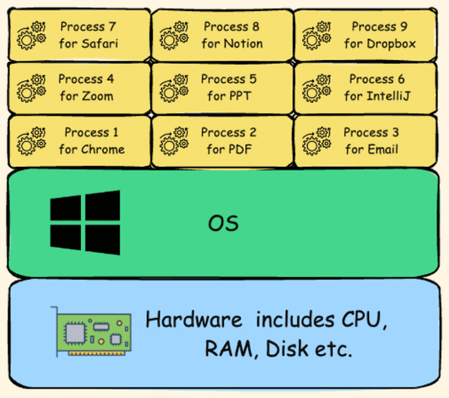
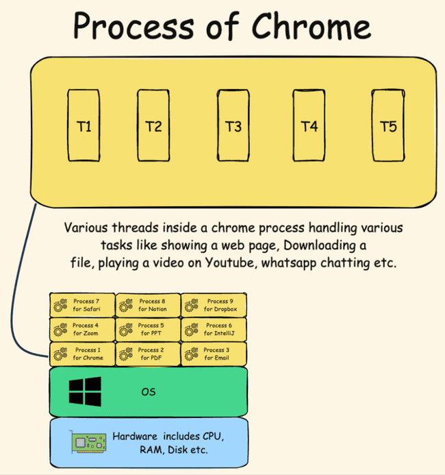
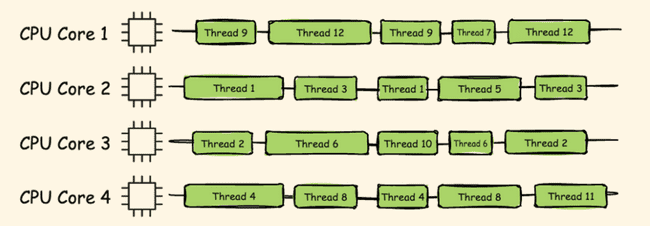
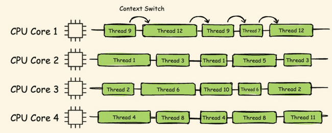
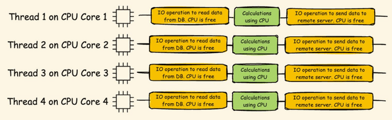
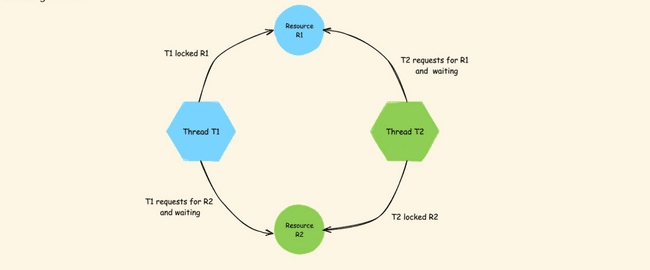

# Threads Overview

**Multithreading** 🡪 One Java program executed by multiple threads

**Process** 🡪 Any program running on the OS is called process like browser, zoom, word etc. Each process running  It is an independent unit that runs in its own memory space. When you open the Chrome browser behind the scenes operating system is going to create a process for the Chrome browser alone.  For this process of Chrome browser, the operating system, it is going to allocate some CPU resources, some Ram memory and similarly some disk memory. So whatever hardware resources needed by my process of Chrome, all those will be assigned by the operating system to the process of Chrome. Each process has its own address space and system resources. So whatever address space or resources assigned to Chrome, it cannot be shared or used by other processes like Edge, Safari etc..



**Thread** 🡪 Usually within software or within a program or within a process, you're trying to perform multiple tasks. To handle all these tasks efficiently or parallelly or simultaneously, threads are going to be created within process. A thread is the smallest unit of execution within a process. Multiple threads can exist within a single process, handling the various activities of the software. For example, inside the business logic of Chrome software, someone might have written the code to create a new thread whenever a new tab is being opened by the end user. These threads are going to request the operating system to provide some resources like CPU time or Ram memory. The threads created within a process are going to share the same memory space allowing for efficient communication. The main purpose of creating threads is they are very lightweight compared to the process. And they can run concurrently behind the scenes



Say a CPU has 4 cores so it can process 4 threads at a time. But at any time, we will see many processes running and about 1000s of threads running. This is achieved by allocating a very short duration to each thread in milliseconds, within which a thread may or may not complete its task. And this way threads are rotated based on an algorithm like round robin. This gives an illusion that hundreds of processes and threads are running at once.



Threads approach the operating system to get a CPU time, or to get any other hardware resource that is required for their execution.

the switching from one thread to other thread by the operating system we call that as context switch.

So whenever a thread want to execute a task, the task can be categorized into two categories.

**CPU-bound** All the tasks that require computational power from the CPU, such as Arithmetic operations, logical processing operations, and relational calculations. All these kinds of calculations and operations, since they need CPU power, we can call these kinds of tasks as CPU-bound task.

**IO-bound tasks** are highly dependent on input output operations. For example, if you're trying to play a YouTube video inside your Chrome browser, it is not a CPU-bound task, it is a IO-bound task because the browser in this scenario it does not require the CPU time instead, it is going to rely on the network of your system to load the video from a remote server. Any task which involves communication over a network or reading or writing operations onto a file or onto a remote server. All these kinds of tasks we can consider them as IO-bound task. And while IO task is being executed, the thread is not going to do any job. It is going to sit ideally behind the scenes because IO-bound tasks are going to be executed based upon the network of your system.





Create thread – Threads can be created using 2 ways either by extending Thread class or by implementing Runnable interface

Thread class has run method we can extend the thread class and override the run method and then with start method from Thread class we can create a new thread.

```java
public class Test extends Thread  {
public static void main(String[] args) {
System.out.println("Main" +"--"+Thread.currentThread().getName());      // Will be done by main thread
```

Test test = new Test();

test.start();

}

@Override

```java
public void run(){
for (int i = 0; i < 4; i++) {
```

//Will be done by new thread

```java
System.out.println("Task from thread "+ i +"--"+Thread.currentThread().getName());
```

}

}

}

Output

Main--main

Task from thread 0--Thread-0

Task from thread 1--Thread-0

Task from thread 2--Thread-0

Task from thread 3--Thread-0

Sometimes our base class already extends some other class in that case we can’t extend another class. In that case we can implement Runnable interface override the run method and pass the instance to thread class to  create new thread.

```java
public class Test implements Runnable  {
public static void main(String[] args) {
System.out.println("Main" +"--"+Thread.currentThread().getName());      // Will be done by main thread
```

Test test = new Test();

Thread thread = new Thread(test);

thread.start();

}

@Override

```java
public void run(){
for (int i = 0; i < 4; i++) {
```

//Will be done by new thread

```java
System.out.println("Task from thread "+ i +"--"+Thread.currentThread().getName());
```

}

}

}

Main--main

Task from thread 0--Thread-0

Task from thread 1--Thread-0

Task from thread 2--Thread-0

Task from thread 3--Thread-0

If we see the thread class it has a constructor which accepts runnable.

```java
public Thread(Runnable target) {    this(null, target, "Thread-" + nextThreadNum(), 0);}
```

Runnable is a functional interface with single abatract method run with no return type and no parameter

@FunctionalInterfacepublic interface Runnable {    public abstract void run();}

Which means we can pass a lambda expression to thread constructor

```java
public class Test {
public static void main(String[] args) {
```

Thread thread = new Thread(

() -> System.out.println("Thread from Lambda" + "--" + Thread.currentThread().getName()));

thread.start();

```java
System.out.println("Main" + "--" + Thread.currentThread().getName()); // Will be done by main thread
```

}

}

Main--main

Thread from Lambda--Thread-0

getId getName method

Thread t1 = new Thread();Thread t2 = new Thread();Thread t3 = new Thread();t3.setName("MyThread");System.out.println("Thread 1 ID is : " + t1.getId() + ", name : "+ t1.getName());System.out.println("Thread 2 ID is : " + t2.getId() + ", name : "+ t2.getName());System.out.println("Thread 3 ID is : " + t3.getId() + ", name : "+ t3.getName());

curerntThread method

Thread mainThread = Thread.currentThread();System.out.println(mainThread.getId());System.out.println(mainThread.getName());

Thread sleep method

long startTime = System.currentTimeMillis();for(int i=0;i<5;i++){    System.out.println("Hello from Main method : " + i);    Thread.sleep(1000);}long endTime = System.currentTimeMillis();System.out.println("Total time taken : " + (endTime-startTime));

**Thread.yield** – It’s a hint to CPU that other threads can be prioritized and this can wait, however CPU can ignore the request

```java
class Task2 implements Runnable {
public void run() {
```

Thread.yield();

```java
for (int i = 51; i < 100; i++) {
System.out.println("Task 2 -> "+ i);
```

}

}

}

**Thread join** - The join() method in Java is provided by the java.lang.Thread class and allows one thread to wait until another thread completes its execution. This method is particularly useful in multithreading scenarios where you need to ensure that a particular thread has finished its task before proceeding with the next one.

E.g. below until custom thread completes the main thread will not execute

```java
public static void main(String[] args) {
```

Thread threadA = new Thread(

() -> {

for(int i=1;i<=5;i++) {

```java
System.out.println("Thread A - count : "+i);
try {
```

Thread.sleep(500);

} catch (InterruptedException e) {

throw new RuntimeException(e);

}

}

}

);

threadA.start();

```java
try {
```

threadA.join();

} catch (InterruptedException e) {

throw new RuntimeException(e);

}

```java
System.out.println("Main thread ended");
```

}

**setPriority()** Thread priority  you can set the priority of a thread using the setPriority method of the Thread class. Thread priorities are integers ranging from Thread.MIN_PRIORITY (which is 1) to Thread.MAX_PRIORITY (which is 10). The default priority is Thread.NORM_PRIORITY (which is 5). Thread priority is just a hint to the thread scheduler. It doesn’t guarantee the order of execution based on priority. The actual behavior can vary depending on the JVM implementation and the underlying operating system. If the threads have same priority it will be executed in FIFO order

```java
public static void main(String[] args) {
```

Thread thread1 = new Thread(() -> System.out.println("Thread1"));

Thread thread2 = new Thread(() -> System.out.println("Thread2"));

Thread thread3 = new Thread(() -> System.out.println("Thread3"));

thread1.setPriority(Thread.MIN_PRIORITY);

thread2.setPriority(Thread.NORM_PRIORITY);

thread3.setPriority(Thread.MAX_PRIORITY);

thread1.start();

thread2.start();

thread3.start();

}

**wait, notify notifyAll** The wait() and notify() methods are used for inter-thread communication. These methods are part of the Object class and are used to manage the synchronization of threads.

- **wait()**: This method causes the current thread to wait until another thread invokes the notify() or notifyAll() method for the same object. The thread releases the lock on the object and enters the waiting state.

- **notify()**: This method wakes up a single thread that is waiting on the object's monitor. If multiple threads are waiting, one of them is chosen to be awakened.

- **notifyAll()**: This method wakes up all the threads that are waiting on the object's monitor.

Say we have a class SharedResource with 2 methods producer and consumer and we want consumer to fire only once after producer has produced something. We do this with Boolean `available`,

when true 🡪 producer won’t emit and will wait

consumer will consume and notify

when false 🡪 producer will produce

consumer won’t consume and will wait

```java
class SharedResource {
```

private boolean available = false;

```java
public synchronized void produce() throws InterruptedException {
while (available) {
```

wait();

}

```java
System.out.println("Producing resource...");
```

available = true;

notify();

}

```java
public synchronized void consume() throws InterruptedException {
while (!available) {
```

wait();

}

```java
System.out.println("Consuming resource...");
```

available = false;

notify();

}

}

Now when main method is triggered it will start produce in one thread, and then consumer in another. When first started available is false so it will not wait and produce change available to false and trigger notify which will start consumer and the process will repeat ensuring after one produce one consume is executed.

```java
public class Test {
public static void main(String[] args) {
```

SharedResource resource = new SharedResource();

Thread producer = new Thread(() -> {

```java
try {
for (int i = 0; i < 5; i++) {
```

resource.produce();

Thread.sleep(1000);

}

} catch (InterruptedException e) {

Thread.currentThread().interrupt();

}

});

Thread consumer = new Thread(() -> {

```java
try {
for (int i = 0; i < 5; i++) {
```

resource.consume();

Thread.sleep(1000);

}

} catch (InterruptedException e) {

Thread.currentThread().interrupt();

}

});

producer.start();

consumer.start();

}

}

**volatile** In a multi-threaded application, each thread may have its own local copy of a variable. When a thread updates a variable, the change might not be immediately visible to other threads. This can lead to inconsistent data and unpredictable behaviour. The volatile keyword ensures that any write to a volatile variable is immediately visible to all threads The volatile keyword in Java is a modifier used to ensure that the value of a variable is always read from and written to the main memory, rather than being cached locally by individual threads.

In below example we are tracking the status of stopFlag Boolean in one thread and changing the status in a different thread. With volatile updated value will reflect instantly as seen from current milliseconds. In local we may not see the difference but a system with complicated logic and more CPU load without volatile will see the difference.

```java
class SharedBooleanResource {    private volatile boolean stopFlag = false;    public void doWork() {        while (!stopFlag) {            System.out.println("Working...--> " +System.currentTimeMillis());        }        System.out.println("Work stopped--> " +System.currentTimeMillis());    }    public void setStopFlag() {        System.out.println("Changing flag to false --> " +System.currentTimeMillis());        stopFlag = true;    }}public class Test {    public static void main(String[] args) throws InterruptedException {        SharedBooleanResource sharedBooleanResource = new SharedBooleanResource();        Thread workerThread = new Thread(sharedBooleanResource::doWork);        Thread stopperThread = new Thread(() -> {            try {                Thread.sleep(2000);                sharedBooleanResource.setStopFlag();            } catch (InterruptedException e) {                throw new RuntimeException(e);            }        });        workerThread.start();        stopperThread.start();        workerThread.join();        stopperThread.join();    }}

```

**Deadlock** Deadlock is a scenario where one of the threads is waiting to acquire the lock of an object currently held by another thread. For e.g.  thread, t1, it is waiting for a object which is already locked by another thread, t2, and the second thread is waiting to obtain the lock of a different object held by the first thread. So consequently, both these threads find themselves in a state of mutual waiting. Expecting each other will release the lock and this will result into a deadlock situation.



Different states of Thread

- New 🡪 created , start method not called yet not running

- Runnable 🡪 Ready to run but not running now, other thread running

- Running 🡪 Running

- Blocked/waiting 🡪Blocked as called some external database or interface and waiting for it to complete or waiting for data from some other thread

- Terminated 🡪 Completed execution
