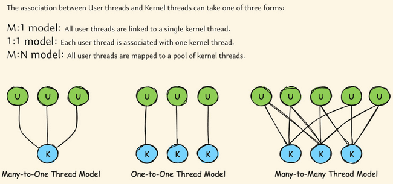

# Virtual Threads

**Introduction** The latest buzzword in Java multithreading is virtual threads. Introduced in Java 21, virtual threads are poised to revolutionize applications that utilize a large number of threads as part of their business logic.

**What Are Virtual Threads?** Virtual threads are a new feature in Java 21. They allow for the creation of millions of threads within a Java program without the resource constraints typical of traditional threads. Unlike traditional threads, which are limited by RAM, memory, and CPU cores, virtual threads are lightweight and can scale significantly better.

Key Differences

- **Traditional Threads:** Heavyweight, limited by system resources.

- **Virtual Threads:** Lightweight, allowing the creation of millions of threads without the same constraints.

**Background and Development** The Oracle team has been working on virtual threads for many years under Project Loom. Project Loom aims to simplify the development, maintenance, and monitoring of high-throughput concurrent applications. After extensive research and testing, virtual threads were introduced in Java 21.

**Understanding Threads in Operating Systems** To fully grasp virtual threads, we need to understand the basics of operating system threads. There are two types of threads in operating systems:

- **Kernel Threads**: Also known as operating system threads, kernel threads are managed and scheduled by the OS kernel. They are resource-intensive, requiring system calls for creation, scheduling, and synchronization.

- **User Threads**: Created by applications and managed at the user level. They are lightweight compared to kernel threads and are created and destroyed quickly.

**Thread Models** The mapping between user threads and kernel threads can be done using three models:

- **M:1 Model:** Many user threads are mapped to a single kernel thread.

- **1:1 Model:** Each user thread is mapped to a single kernel thread.

- **M:N Model:** Many user threads are mapped to a pool of kernel threads.

**Implications for Java** In Java, the application starts with a default thread to run the main() method. Additional user threads can be created as needed. These user threads are executed by kernel threads, meaning each user thread must be mapped to a kernel thread to get CPU time.

**Evolution of Threading** in Java Java has evolved to support different threading models, and virtual threads represent the latest advancement. By using lightweight virtual threads, Java programs can achieve higher concurrency without the performance bottlenecks associated with traditional threads.

Early Days of Java: Green Threads

When Java first appeared in the 1990s, it used a thread model known as green threads. These green threads were implemented entirely in the Java Virtual Machine (JVM) and mapped multiple user-level threads to a single kernel thread, following a many-to-one model.

Key Characteristics of Green Threads:

- **Execution and Scheduling**: Green threads were managed by the JVM, which was responsible for scheduling and overseeing these threads.

- **Performance**: While green threads were fast in terms of creation and execution, they had significant drawbacks:

- **Scalability**: Java could not effectively leverage multiple CPU cores. Regardless of the number of cores, all user threads were mapped to a single kernel thread.

- **Complexity**: Libraries or programs needed to know low-level JVM details, increasing the learning curve and complexity.

Limitations of Green Threads:

- **Single-Core Limitation**: During the 1990s, CPUs typically had a single core. As hardware advanced and multi-core processors became standard, the green thread model could not take advantage of multiple cores.

- **JVM Overhead**: The JVM's responsibility for mapping and scheduling threads added overhead and limited scalability.

Due to these limitations, green threads were phased out after Java 1.1. From Java 1.2 onwards, Java introduced native threads.

**Native Threads (Platform Threads)** Starting from Java 1.2, Java adopted a one-to-one thread model, where each user thread maps directly to a kernel thread. These threads are known as native threads or platform threads.

Key Characteristics of Native Threads:

- **Mapping**: Each user thread corresponds to a single kernel thread.

- **Management**: Managed by the JVM with the operating system's assistance.

- **Performance**: High efficiency during execution, but with notable costs for starting and stopping threads.

Limitations of Native Threads:

- **Resource Intensive**: Creating and maintaining native threads is resource-intensive. Each thread requires memory for its call stack and local memory, ranging from 1MB to 20MB.

- **Limited Scalability**: The number of threads that can be created is limited by the available RAM. For example, on a system with 8GB of RAM, creating 1 million native threads is impractical.

- **Context Switching**: Context switching between threads involves system calls to the kernel, which is an expensive operation.

Despite these limitations, native threads have been the standard from Java 1.2 to Java 20.

**Virtual Threads: The Future of Java Concurrency**With Java 21, a new type of thread model, known as virtual threads, was introduced. Virtual threads aim to address the limitations of native threads and provide a more scalable and efficient threading model.

Advantages of Virtual Threads:

- **Lightweight**: Virtual threads are lightweight and can be created in large numbers without significant memory overhead.

- **Efficient Resource Utilization**: Virtual threads utilize CPU resources more efficiently, minimizing idle time during I/O operations.

- **Scalability**: Virtual threads allow for the creation of millions of threads, making it easier to scale applications and handle large numbers of concurrent tasks.

Example Scenario: Web Server with Native Threads vs. Virtual Threads

Consider a web server with 16GB of RAM running a web application. Each incoming request is handled by a separate thread. With native threads, creating 1600 threads (assuming each thread requires 10MB of RAM) utilizes all available memory, limiting the server's capacity to handle concurrent requests.

However, with virtual threads, the server can handle significantly more requests. Since virtual threads are lightweight, they do not consume as much memory, allowing for the creation of millions of threads. This scalability improves the server's ability to handle high loads and increases overall performance.

**Conclusion** Java's thread model has evolved from green threads in the early versions to native threads and now virtual threads. Each transition has addressed the limitations of the previous model, resulting in more efficient and scalable concurrency mechanisms. Virtual threads, introduced in Java 21, promise to revolutionize how Java applications handle concurrency, making it easier to build scalable and high-performance applications.

Java 21 introduces virtual threads, a significant enhancement over traditional platform or native threads. Let's explore the advantages of virtual threads and how they work.

Advantages

- Lightweight:

- Virtual threads are extremely lightweight, consuming only a few bytes of memory.

- In contrast, platform threads require between 1MB to 20MB of memory, sometimes even more.

- This drastic reduction in memory footprint allows for the creation of a vast number of virtual threads without overwhelming the system's RAM.

- Scalability:

- Due to their minimal memory requirements, you can create millions of virtual threads.

- This scalability is a game-changer, enabling applications to handle massive concurrency without significant overhead.

- No System Calls for Creation:

- Creating a virtual thread does not require a system call to the kernel.

- The mapping between a virtual thread and the kernel thread is managed indirectly, reducing the overhead associated with thread creation.

- Efficient Creation and Destruction:

- Virtual threads can be created and destroyed extremely quickly, often in nanoseconds.

- This efficiency further enhances the system's ability to handle high concurrency.

- Enhanced CPU Utilization:

- Virtual threads utilize the M:N threading model, where many virtual threads are mapped to a smaller number of OS threads.

- JVM creates a pool of platform threads at startup, which are then used to execute virtual threads.

- When a virtual thread performs an IO operation, it detaches from its platform thread, allowing the platform thread to execute another virtual thread. This reduces idle time and improves CPU utilization.

- Reduced Context Switching Overhead:

- Context switching between virtual threads is managed by the JVM and does not involve system calls.

- This reduction in overhead improves the performance and responsiveness of applications.

How Virtual Threads Work

- JVM Initialization:

- Upon startup, the JVM creates a set of platform threads.

- These platform threads are mapped to OS threads and are ready to execute virtual threads.

- Creation of Virtual Threads:

- Developers can create numerous virtual threads within the Java heap memory, thanks to their lightweight nature.

- Execution and Management:

- The JVM manages the mapping of virtual threads to platform threads.

- When a virtual thread is assigned to a platform thread, its instructions are executed promptly.

- After execution, the virtual thread can be destroyed or kept in a waiting state if it is waiting for an IO operation.

- Handling IO Operations:

- During IO operations, virtual threads detach from their platform threads.

- This allows the platform threads to be reassigned to other virtual threads that need CPU time, maximizing CPU utilization.

Conclusion

Virtual threads in Java 21 offer a robust solution for handling high concurrency with minimal overhead. Their lightweight nature, scalability, efficient creation and destruction, enhanced CPU utilization, and reduced context switching overhead make them a powerful tool for modern Java applications.
