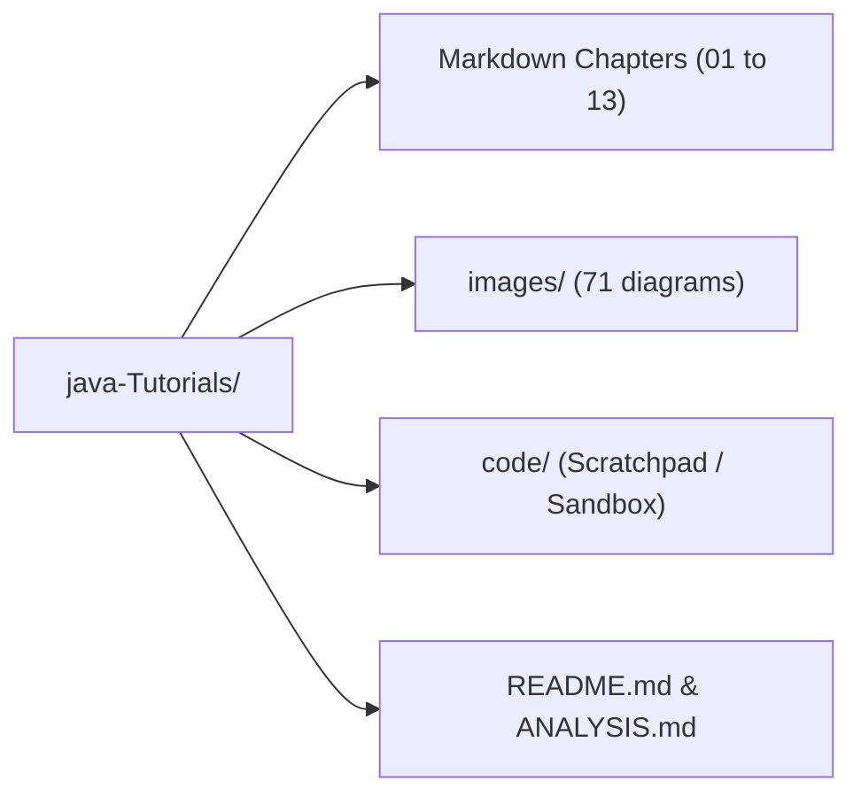

# 📊 Java Learning Repository — Comprehensive Analysis Report

> **Repository:** Java Tutorials Knowledge Base  
> **Date of Analysis:** August 25, 2026  
> **Environment:** OpenJDK 26.0.2 (`javac` 26.0.2 / `java` 26.0.2)  

---

## 1. Executive Summary

This repository is a comprehensive, structured Java tutorial knowledge base designed for learning core Java concepts, object-oriented design, collections, functional programming, multithreading, and modern Java features (Java 8 through Java 21+).

### Key Repository Metrics

| Metric | Count | Details |
| :--- | :--- | :--- |
| **Total Markdown Files** | **90** | 1 [`README.md`](./README.md) + 89 topic chapters across 13 modules |
| **Total Documentation Lines** | **8,906** | From beginner fundamentals to modern virtual threads |
| **Visual Assets (`images/`)** | **71** | Architectural diagrams, memory layouts, flowcharts |
| **Markdown Link Integrity** | **100% Valid** | 0 broken markdown links across all 90 files |
| **Image Reference Integrity** | **100% Valid** | 0 broken image references; 0 unreferenced image assets |
| **README Index Coverage** | **100%** | All 89 topic notes are fully indexed in [`README.md`](./README.md) |
| **Scratchpad / Sandbox Folder** | **`code/`** | Reserved for interactive testing of code snippets (e.g., [`code/Test.java`](./code/Test.java)) |

---

## 2. Directory Architecture & Role of `code/`



### Role of `code/`
The [`code/`](./code) directory (containing files such as [`Test.java`](./code/Test.java)) is designated as a **scratchpad / sandbox playground**. It is used to quickly run, experiment with, and verify code snippets extracted from the tutorial notes without interfering with the documentation structure.

---

## 3. Chapter-by-Chapter Inventory & Coverage

| Module / Directory | Files | Total Lines | Core Focus & Covered Topics |
| :--- | :---: | :---: | :--- |
| [`01_Java/`](./01_Java) | 6 | 394 | JVM Architecture, Bytecode generation, JIT compilation & C1/C2 tiers, Cold start / AppCDS, Memory allocation (Heap vs Stack). |
| [`02_Data_Types_Operators/`](./02_Data_Types_Operators) | 5 | 542 | Primitive types, Type casting (Widening/Narrowing), Autoboxing/Unboxing, Operators, Control flow, String immutability & String Constant Pool. |
| [`03_Classes_Object/`](./03_Classes_Object) | 13 | 1,333 | Packages, Class members, `static`, `this`, Access modifiers, Method overloading, Pass-by-value semantics, Inner/Nested classes, `Object` class (`equals`, `hashCode`, `toString`), `Record` / Immutability, `var`, Arrays, Enums. |
| [`04_Inheritance/`](./04_Inheritance) | 7 | 511 | IS-A relationships, Upcasting/Downcasting, Static vs Dynamic binding, Method overriding rules, `super`, `final`, Sealed classes & interfaces (`permits`). |
| [`05_Interface/`](./05_Interface) | 5 | 367 | Runtime polymorphism, Interface default/static methods, Diamond problem resolution, Marker interfaces, Abstract classes. |
| [`06_Generics/`](./06_Generics) | 5 | 390 | Type parameters `<T>`, Type erasure, Covariance/Invariance, Upper bounded `<? extends T>`, Lower bounded `<? super T>`, Unbounded `<?>` wildcards. |
| [`07_Error_and_Exception/`](./07_Error_and_Exception) | 10 | 393 | Stack unwinding, Exception propagation, Multi-catch, Catch block hierarchy, `finally` execution, Try-with-resources (`AutoCloseable`), `throw`/`throws`, Custom exceptions. |
| [`08_Collections/`](./08_Collections) | 7 | 1,912 | List (`ArrayList`, `LinkedList`, `Vector`), Map (`HashMap`, `LinkedHashMap`, `TreeMap`, `ConcurrentHashMap`), Set (`HashSet`, `LinkedHashSet`, `TreeSet`), Queue (`PriorityQueue`, `Deque`), `Collections` utilities, `Comparable` vs `Comparator`. |
| [`09_Date_Time/`](./09_Date_Time) | 9 | 277 | Legacy `Date`, `SimpleDateFormat`, `Calendar`, `TimeZone`, Modern `java.time` API (`LocalDate`, `LocalTime`, `LocalDateTime`, `Instant`, `Period`, `Duration`, `ZoneOffset`, `ZonedDateTime`). |
| [`10_Files_I_and_O/`](./10_Files_I_and_O) | 5 | 286 | I/O Streams, `File` API, Byte streams (`FileInputStream`/`FileOutputStream`), Character streams (`FileReader`/`FileWriter`), Buffered I/O wrappers. |
| [`11_Functional_Programming/`](./11_Functional_Programming) | 12 | 1,064 | Lambdas, `@FunctionalInterface`, Core functional interfaces (`Predicate`, `Function`, `Consumer`, `Supplier`), Method references `::`, `Optional`, Stream API (Terminal & Intermediate operations), Primitive streams, Parallel streams. |
| [`12_Threads/`](./12_Threads) | 4 | 956 | Thread lifecycle, `Runnable` vs `Callable`, Synchronization & Locks, `ExecutorService`, Java 21 Virtual Threads (Project Loom, Carrier threads, Continuations). |
| [`13_Questions/`](./13_Questions) | 1 | 481 | Comprehensive technical interview questions covering OOP, Collections internals, Memory management, and Concurrency nuances. |

---

## 4. Key Strengths

1. **Structured Learning Curve:** The repository progresses cleanly from basic Java fundamentals to enterprise-grade concurrency and modern Java 21 features.
2. **Visual Memory & Architecture Diagrams:** 71 well-placed diagrams explain complex runtime mechanics such as HashMap collision buckets, JVM Heap regions, Thread scheduling states, and String pool deduplication.
3. **Flawless Link Integrity:** Zero broken relative markdown links and zero orphaned image assets. Every file is indexed in [`README.md`](./README.md).
4. **Rich Deep-Dive Sections:** Collections (1,912 lines), Functional Programming (1,064 lines), and Multithreading (956 lines) offer exceptional technical detail.

---

## 5. Audit Findings & Areas for Improvement

The inspection revealed formatting, naming, and content artifacts (likely originating from an earlier export from Word / Joplin):

### A. Typos in Filenames & Nomenclature
- `09_Date_Time/04_Calender.md` — Spelled `Calender` instead of `Calendar`.
- `09_Date_Time/07_Instance.md` — Named `Instance` instead of `Instant` (`java.time.Instant`).
- `12_Threads/02_Executer_Service.md` — Spelled `Executer` instead of `Executor` (`ExecutorService`).

### B. Code Block Syntax Tagging
- **Untagged Code Fences:** 341 code blocks across 68 files use generic ` ``` ` without specifying language identifiers (e.g., ` ```java ` or ` ```bash `), which impairs syntax highlighting in Markdown viewers and IDEs.

### C. Squashed Multi-Statement Code Lines (55 Instances)
- Several code snippets were flattened into a single line during document conversion.
  - *Example in `09_Date_Time/02_Date.md`:*
    ```java
    Date date = *new* Date(124,11,18);System.out.println(date);   ***//Wed Dec 18 00:00:00 IST 2024***
    ```
  - *Example in `06_Generics/01_Generics_Overview.md`:*
    ```java
    class Response<T> {    private T data;    public Response(T data) {        this.data = data;    } ...
    ```

### D. Word / Joplin Conversion Residue
- **Keyword Italic Markers:** Keywords wrapped in asterisks like `*new*`, `*null*`, `*this*`, `*out*` across 12 files.
- **Raw Joplin Table HTML:** Joplin wrapper `<div class="joplin-table-wrapper">` in `01_Java/01_Java_Overview.md`.
- **Non-Breaking Spaces:** 26 files contain `\xa0` characters.

### E. Stub / Short Notes (< 15 lines)
- `03_Classes_Object/11_Var.md` (3 lines) — Needs examples of valid/invalid `var` usage, compound assignments, and limitations.
- `05_Interface/05_Abstract_class.md` (10 lines) — Incomplete comparison table with interfaces.
- `07_Error_and_Exception/01_Error_and_Exception_Overview.md` (5 lines) — Minimal introductory text.
- `08_Collections/06_Collection_Utility_Methods.md` (19 lines) — Method list lacks signatures and executable examples.
- `09_Date_Time/03_Simple_Date_Format.md` (9 lines) — Contains squashed code without thread-safety notes (`DateTimeFormatter` recommendation).
- `11_Functional_Programming/01_Functional_Programming_Overview.md` (7 lines) — Minimal introductory text.

### F. Interview Questions Inconsistencies (`13_Questions/01_Java_Interview_Questions.md`)
- **Unanswered Question:** `### Q: What is constructor overloading ?` is present with no answer provided.
- **Inaccurate Explanation:** Line 29 states *"Methods can be called only once constructors are called only when class is initialized"*.
- **Broken Table Formatting:** Question on `Comparable vs Comparator` uses raw ASCII broken box characters (`¦`).

---

## 6. Actionable Recommendations & Roadmap

1. **Phase 1: Formatting & Clean-Up**
   - Standardize all code fences with ` ```java `.
   - Expand all squashed single-line code blocks into readable, multi-line format.
   - Clean up word export artifacts (`*new*`, `*null*`, Joplin HTML wrappers, non-breaking spaces).
2. **Phase 2: Content Expansion of Stub Chapters**
   - Flesh out `var`, `Abstract class`, `Collection Utility Methods`, `SimpleDateFormat` vs `DateTimeFormatter`, and chapter overviews.
3. **Phase 3: Interview Questions Polish**
   - Add missing answers, correct method/constructor explanations, and format comparison tables cleanly.
4. **Phase 4: Filename & Link Normalization (Optional)**
   - Fix misspelled file names (`Calendar`, `Instant`, `ExecutorService`) while maintaining synchronized links in `README.md`.

---
*Report generated and documented for the Java Tutorials Knowledge Base repository.*
